# CargoMind Stage 02 — Exploratory Data Analysis of the DL Dataset

Generated by `DL/EDA/scripts/run_eda.py` from `DL/Dataset/processed/`, the dataset built by `DL/Dataset/scripts/build_dl_dataset.py`. No model was trained, no scaler or transform was fitted, and nothing in `DL/Dataset/processed/` or `ML/Dataset/Processed/` was changed.

**Data use:**
- Target, temporal, feature and reconstruction analyses use the **development period** only, i.e. training and validation hours.
- Test-period numbers appear only in section 9, as a descriptive warning.
- All statistics are in original units. The saved scalers were only applied to verify the stored arrays.

All figures are in `DL/EDA/plots/`, and all numbers are in `DL/EDA/reports/eda_summary.json`.

## 1. Executive summary

- **The dataset is structurally sound.** 27 of 27 sanity checks pass.
  - Arrays, schema, manifest hashes, window counts and split membership all agree.
  - Every `X` value reproduces exactly from the hourly panel with the saved scalers.
  - No data integrity problem was found, so the dataset was not rebuilt.
- **Dwell levels differ strongly between ports.**
  - Ports explain 71.2 % of development-target variance.
  - NLRTM alone accounts for 47.6 % of the total sum of squares.
  - Per-port scaling, which the dataset already uses, is necessary.
- **Hour-to-hour behaviour is a slowly moving level plus independent hourly noise.**
  - Lag-1 autocorrelation of the hourly *change* is close to −0.5 at every port (-0.53 to -0.43).
  - The implied noise SD is 3.5–4.4 h (pooled ≈ 3.9 h).
  - Noise is 89 % of dwell variance at MYPKG, but only 1 % at NLRTM.
- **The forecastable headroom is small.**
  - The validation EWMA RMSE (4.30 h) is already within about 0.4 h of the noise floor.
  - An LSTM can only add value by anticipating level changes, which happen in disruption and backlog episodes.
- **The informative operational signals, beyond the window's own dwell history,** are:
  - utilization (partial r -0.20);
  - disruption state (active 0.18, elapsed 0.15);
  - labour strike (0.12);
  - vessels at anchor (0.11);
  - wind gusts (0.09).
  - All are modest. None is constant or useless.
- **Strike data is very thin in development:** 4 episodes, at 4 ports only. The test period has strikes at INNSA, MYPKG, which never strike in development data.
- **Reconstructed dwell inputs show no measurable effect.**
  - They are spread evenly over ports (χ² p = 0.978) and days (p = 0.141).
  - They deviate from neighbouring observed hours just as observed values do (KS p = 0.235).
  - Windows containing them have the same EWMA error (Mann-Whitney p = 0.65).
- **There is clear train → validation shift at some ports.** CNSHA's dwell level rises by 1.34 training SDs and USLAX's falls by 0.80. Disruption exposure halves (16.9 % → 8.3 % of hours).

**Verdict: the dataset is ready for LSTM training,** under the evaluation discipline in section 12.

## 2. Dataset structure and sanity checks

| Split | X | provenance | y | Hours covered (UTC) | Windows per port |
|---|---|---|---|---|---|
| train | [6579, 12, 7] | [6579, 12, 5] | [6579] | 2025-01-01 00:00 → 2025-01-30 03:00 | 653–663 |
| val | [1306, 12, 7] | [1306, 12, 5] | [1306] | 2025-01-30 04:00 → 2025-02-05 09:00 | 125–135 |
| test | [1318, 12, 7] | [1318, 12, 5] | [1318] | 2025-02-05 10:00 → 2025-02-11 15:00 | 128–135 |

**Channels.** The order, from `feature_schema.json`, is:
`dwell`, `utilization`, `labour_strike`, `wind_gust`, `disruption_active`, `disruption_hours_elapsed`, `vessels_at_anchor`.

**Scaling and target:**
- Inputs are stored **scaled**:
  - dwell: per-port z-score;
  - utilization: ÷ 100;
  - wind gust: global z-score;
  - hours since disruption began: log1p, then global z-score;
  - vessels at anchor: log1p, then per-port z-score;
  - binary channels: unscaled.
- The target `y` is the **per-port z-score of next-hour dwell**. It is stored in hours as `y_hours`.
- `dataset.to_hours` inverts the scaling with the saved scaler (max error < 1e-5 h).
- The **reconstruction indicator is not in the saved `X`.** `dataset.load_split()` appends it by default, so the actual model input is `[N, 12, 8]` with channels `dwell`, `utilization`, `labour_strike`, `wind_gust`, `disruption_active`, `disruption_hours_elapsed`, `vessels_at_anchor`, `dwell_reconstructed`.

| Check | Result | Evidence |
|---|---|---|
| train: all arrays have the same number of windows | PASS | N = 6579 |
| train: X is [N, 12, 7] and provenance [N, 12, 5] | PASS | X (6579, 12, 7), provenance (6579, 12, 5) |
| train: X and y finite (no NaN / inf) | PASS |  |
| train: window count matches split_metadata.json | PASS | 6579 vs 6579 |
| train: provenance codes only in {0,1,2} | PASS |  |
| val: all arrays have the same number of windows | PASS | N = 1306 |
| val: X is [N, 12, 7] and provenance [N, 12, 5] | PASS | X (1306, 12, 7), provenance (1306, 12, 5) |
| val: X and y finite (no NaN / inf) | PASS |  |
| val: window count matches split_metadata.json | PASS | 1306 vs 1306 |
| val: provenance codes only in {0,1,2} | PASS |  |
| test: all arrays have the same number of windows | PASS | N = 1318 |
| test: X is [N, 12, 7] and provenance [N, 12, 5] | PASS | X (1318, 12, 7), provenance (1318, 12, 5) |
| test: X and y finite (no NaN / inf) | PASS |  |
| test: window count matches split_metadata.json | PASS | 1318 vs 1318 |
| test: provenance codes only in {0,1,2} | PASS |  |
| no channel is constant within any split | PASS | {"train": [], "val": [], "test": []} |
| every window_id is unique across splits | PASS | 9203 windows |
| each window maps to exactly one kept windows.csv row with the same split | PASS |  |
| port_index agrees with windows.csv port_id and schema port list | PASS | AEJEA, CNSHA, DEHAM, INMAA, INNSA, LKCMB, MYPKG, NLRTM, SGSIN, USLAX |
| target hour = last input hour + 1, and no reconstructed target | PASS |  |
| per-port window counts match sequence_counts.csv | PASS |  |
| DL/Dataset/processed files match manifest.json SHA-256 | PASS | mismatched: none |
| saved dwell scaler inverts y to y_hours | PASS | max |Δ| 9.7e-06 h |
| saved dwell scaler inverts X[:, -1, 0] to last_dwell_hours | PASS | max |Δ| 9.7e-06 h |
| all X values reproduce from hourly_panel.csv with the saved scalers (12 consecutive hours per window) | PASS | max |Δ| 0.0e+00 |
| provenance arrays equal the hourly_panel provenance codes | PASS | all windows, all splits |
| reconstruction indicator is NOT in saved X; dataset.load_split appends it as channel 8 | PASS | loader channels: ['dwell', 'utilization', 'labour_strike', 'wind_gust', 'disruption_active', 'disruption_hours_elapsed', 'vessels_at_anchor', 'dwell_reconstructed'] |

**No inconsistencies were found.** As expected, the scaled channel means of validation and test drift away from 0 (for example the test dwell mean is -0.24), because the scalers were fitted on training hours only.

## 3. Target variable: next-hour container dwell time

The analysis uses observed or unit-converted targets of the kept windows. Reconstructed targets are not in the dataset.

| Statistic (h) | Train | Validation |
|---|---|---|
| n | 6579 | 1306 |
| mean | 90.33 | 90.94 |
| median | 84.80 | 87.60 |
| std | 23.95 | 21.58 |
| min | 55.30 | 54.60 |
| max | 205.20 | 158.20 |
| q1 | 70.90 | 72.00 |
| q3 | 105.50 | 105.80 |
| iqr | 34.60 | 33.80 |
| skewness | 1.52 | 0.62 |
| excess_kurtosis | 3.68 | -0.39 |
| outliers_iqr_rule | 175 | 2 |

**Shape.**
- The pooled distribution is right-skewed (training skewness 1.52, excess kurtosis 3.68).
- The skew comes from mixing ports with different levels and from NLRTM's long backlog episode (up to 205.2 h).
- Within each port the distribution is far closer to symmetric (`B1_target_distribution.png`, right panel).
- Pooled IQR "outliers" are mostly high-level ports, not errors.
- With the IQR rule applied within each port, flags range from 0 (NLRTM, USLAX) to 49, Because the audit found no single-hour jump beyond 6 robust SDs, these are hours of high level, not spikes, and need no correction.

| Port | Train mean | Train SD | Min | Max | Skew | Val mean | Val − train (train SDs) | KS p (train vs val) |
|---|---|---|---|---|---|---|---|---|
| AEJEA | 105.6 | 4.6 | 92.5 | 122.7 | 0.43 | 104.9 | -0.16 | 0.203 |
| CNSHA | 82.5 | 15.3 | 60.0 | 117.5 | 0.54 | 102.9 | 1.34 | 2.97e-57 |
| DEHAM | 68.5 | 4.4 | 55.3 | 81.5 | 0.17 | 69.5 | 0.22 | 0.0185 |
| INMAA | 70.1 | 5.0 | 57.4 | 88.6 | 0.66 | 68.9 | -0.23 | 0.0675 |
| INNSA | 85.7 | 10.1 | 64.5 | 120.2 | 1.13 | 84.1 | -0.16 | 0.08 |
| LKCMB | 107.3 | 6.1 | 92.9 | 129.9 | 1.02 | 113.0 | 0.93 | 8.69e-19 |
| MYPKG | 67.8 | 4.1 | 56.4 | 79.6 | 0.13 | 67.5 | -0.09 | 0.379 |
| NLRTM | 133.0 | 31.5 | 96.4 | 205.2 | 0.80 | 132.6 | -0.01 | 1.13e-28 |
| SGSIN | 82.4 | 10.8 | 64.6 | 120.9 | 1.29 | 76.0 | -0.58 | 2.2e-09 |
| USLAX | 100.7 | 13.9 | 78.5 | 139.2 | 0.68 | 89.5 | -0.80 | 1.22e-17 |

**Levels over time.** Dwell levels move in multi-day episodes rather than following a trend (`B3_target_timeseries_rolling.png`, ports MYPKG, INNSA, NLRTM). The 24-hour rolling SD is about 4–5 h in calm periods and rises during build-ups and decays (`B4_rolling_sd_by_port.png`).

**Train vs validation.** Pooled, the distributions are similar (KS 0.054), but this hides opposite movements at individual ports. CNSHA (+1.3 SD) and LKCMB (+0.9) are higher in validation, while USLAX (−0.8) and SGSIN (−0.6) are lower. Section 9 covers this.

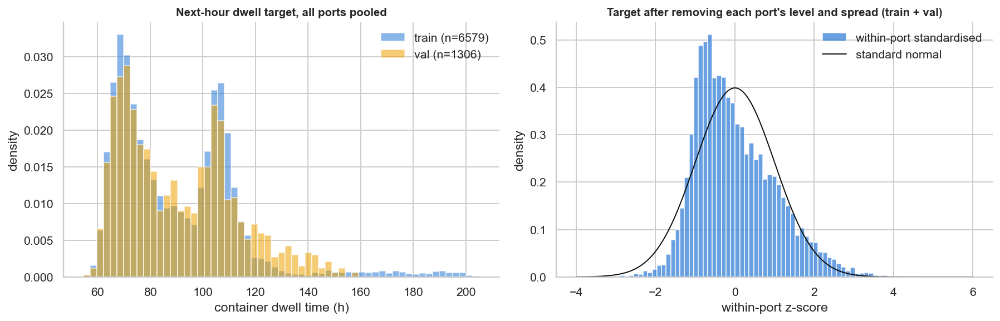

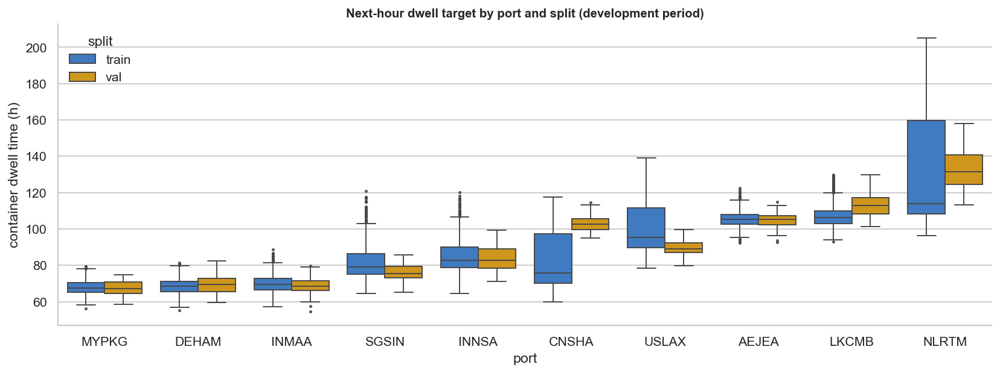

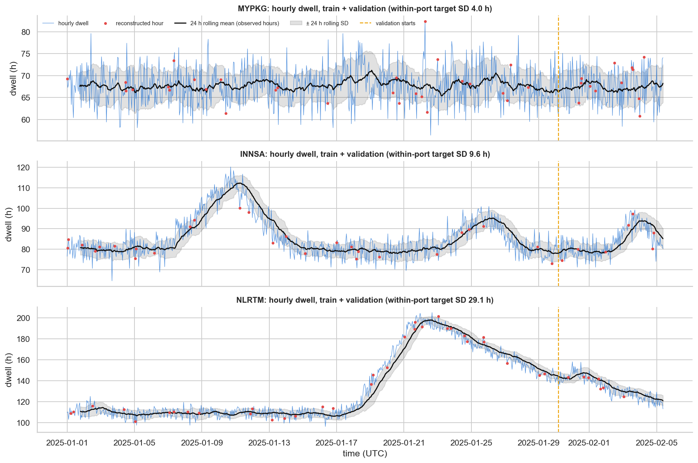

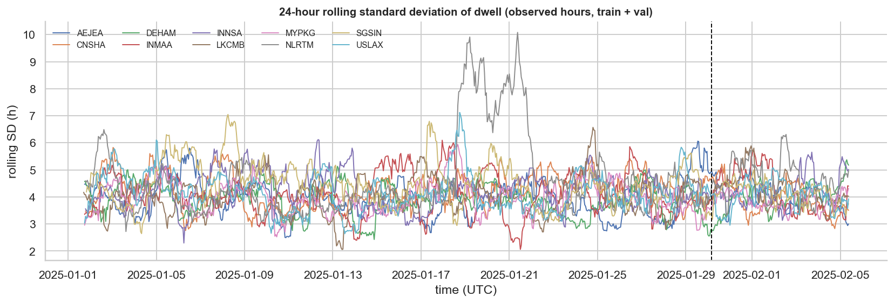

## 4. Temporal analysis

| Port (by signal share) | ACF 1 | ACF 12 | ACF 24 | PACF 1 | PACF 2 | PACF 12 | ACF of Δ, lag 1 | Noise SD (h) | Signal share |
|---|---|---|---|---|---|---|---|---|---|
| NLRTM | 0.97 | 0.96 | 0.94 | 0.98 | 0.41 | 0.00 | -0.43 | 3.54 | 99 % |
| CNSHA | 0.94 | 0.93 | 0.90 | 0.94 | 0.50 | 0.01 | -0.50 | 4.04 | 93 % |
| USLAX | 0.92 | 0.90 | 0.85 | 0.92 | 0.48 | -0.01 | -0.50 | 3.83 | 92 % |
| INNSA | 0.85 | 0.81 | 0.71 | 0.84 | 0.43 | 0.04 | -0.44 | 3.55 | 87 % |
| SGSIN | 0.86 | 0.82 | 0.77 | 0.82 | 0.47 | -0.01 | -0.53 | 4.35 | 83 % |
| LKCMB | 0.64 | 0.58 | 0.44 | 0.63 | 0.39 | 0.00 | -0.50 | 3.95 | 58 % |
| INMAA | 0.29 | 0.27 | 0.19 | 0.28 | 0.17 | 0.04 | -0.47 | 3.94 | 36 % |
| AEJEA | 0.28 | 0.15 | 0.06 | 0.27 | 0.25 | -0.03 | -0.51 | 3.83 | 30 % |
| DEHAM | 0.24 | 0.19 | 0.13 | 0.25 | 0.19 | 0.05 | -0.50 | 3.88 | 22 % |
| MYPKG | 0.06 | 0.06 | 0.07 | 0.07 | 0.04 | 0.03 | -0.48 | 3.82 | 11 % |

The ACF is computed from pairs of observed hours. Including reconstructed hours changes it by at most 0.04.

**What the temporal structure shows:**
1. **Level plus noise.**
   - Every port's hourly change has lag-1 autocorrelation ≈ −0.5, and essentially none at lags ≥ 2. This is the signature of independent hourly noise on top of a smooth level.
   - The noise SD (3.5–4.4 h) is almost the same at every port.
   - What differs is the level's variability. *Signal share* is the fraction of dwell variance that is not hourly noise: 99 % at NLRTM, but 11 % at MYPKG.
2. **Persistence, not momentum.**
   - At episodic ports, ACF stays high for days (NLRTM ACF 24 h 0.94).
   - The PACF decays over lags 1–3 and is ≈ 0 by lag 12.
   - Averaging several recent hours therefore helps, but hours beyond the window add little given the window.
3. **Rapid reversals are noise.**
   - A single-hour jump is followed by a partial reversal (the negative ACF of Δ).
   - That is why repeating the last hour (persistence) is a poor forecast, and why averaging beats it.

**Is 12 hours enough?** Descriptive smoothing errors on development targets (nothing fitted; same targets for every length):

| Summary of past dwell | RMSE next hour (h) |
|---|---|
| EWMA alpha 0.2 (full history) | 4.310 |
| EWMA alpha 0.3 (full history) | 4.360 |
| trailing mean 6 h | 4.364 |
| trailing mean 12 h | 4.364 |
| EWMA alpha 0.1 (full history) | 4.486 |
| EWMA alpha 0.5 (full history) | 4.590 |
| trailing mean 3 h | 4.601 |
| trailing mean 24 h | 4.744 |
| trailing mean 2 h | 4.864 |
| EWMA alpha 0.05 (full history) | 5.146 |
| trailing mean 1 h | 5.570 |
| trailing mean 48 h | 5.810 |

- Trailing means of 6–12 h are best (4.364 h). 24 h is worse (4.744), and 48 h worse still (5.810), because levels move.
- The EWMA with α = 0.2 over the full history (4.310) is barely better than the in-window 12 h mean, and its effective memory is ≈ 5 h.
- Given the window EWMA, the mean dwell of hours t−47 … t−12 has partial r -0.07. Older history adds essentially nothing.
- **12 hours is sufficient.**

**Daily and weekly patterns:**
- Deviation from a centred 24-hour mean varies by local hour with an amplitude of 1.15 h.
- That is statistically detectable (p = 0.00273) but explains 0.58 % of the variance, which is negligible.
- No day-of-week effect is detectable (p = 0.89), and 5.06 weeks are too few to establish one.
- No calendar channels are needed.

**What this means for an LSTM:**
- The univariate part of the problem is close to solved by exponential smoothing.
- A recurrent model can learn that smoothing, but its gain must come from:
  - recognising level changes earlier, from operational inputs;
  - non-linear episode dynamics (build-up and decay).
- Expect gains, if any, of a few tenths of an hour of RMSE: the EWMA is ≈ 0.4 h above the noise floor on validation.

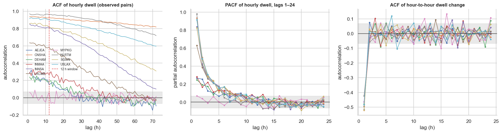

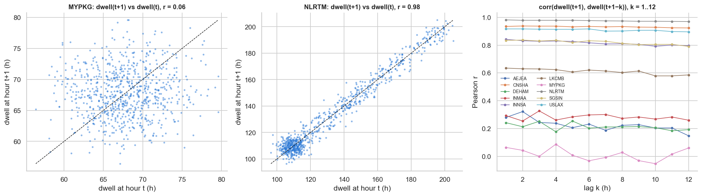

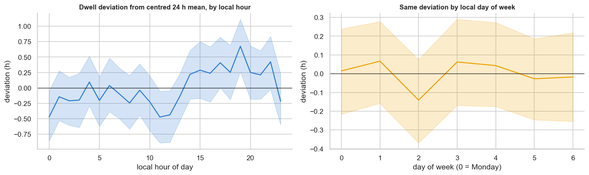

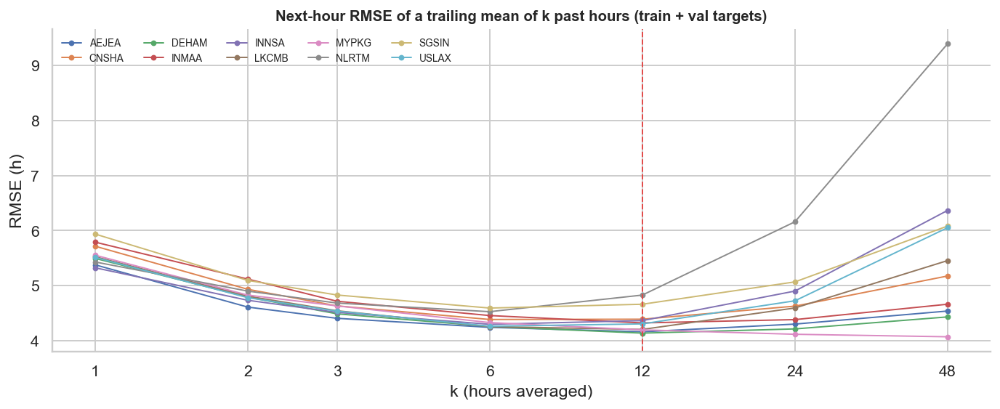

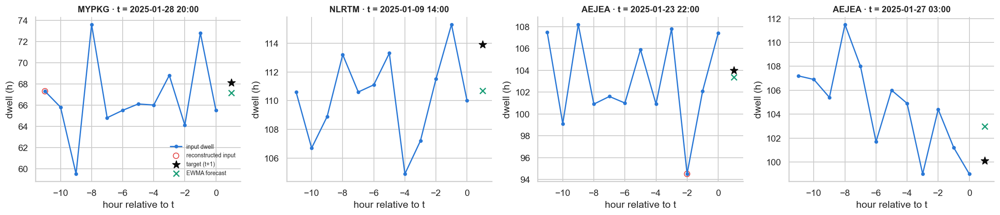

## 5. Feature analysis (development hours, original units)

| Feature | Type | Range | Median | SD | Median within-port SD | Notes |
|---|---|---|---|---|---|---|
| dwell | continuous (h) | 54.6 – 205.2 | 85.2 | 23.59 | 7.96 | between-port variance 72 % |
| utilization | continuous, bounded 0-100 %, right-censored at 100 | 9.1 – 100.0 | 75.5 | 17.27 | 15.20 | 16.8 % of hours at 100 (censored); between-port variance 13 % |
| labour_strike | binary | 0.0 – 1.0 | 0.0 | 0.17 | 0.00 | prevalence 2.9 %; 4 episodes; ports with any: 4/10 |
| wind_gust | continuous (km/h) | 0.0 – 105.7 | 24.3 | 13.55 | 12.00 | 1 negative value clipped to 0 in the dataset build |
| disruption_active | binary | 0.0 – 1.0 | 0.0 | 0.36 | 0.35 | prevalence 15.4 %; 42 episodes; ports with any: 10/10 |
| disruption_hours_elapsed | count-like hours, zero-inflated | 0.0 – 96.0 | 0.0 | 12.58 | 9.70 | 85.1 % zeros; when active: median 17 h, p90 60 h, max 96 h |
| vessels_at_anchor | count (vessels) | 0.0 – 33.0 | 1.0 | 3.81 | 2.09 | 48.3 % zeros; overdispersed (variance/mean ≈ 2.9 per port) |

**Per feature:**
- **Binary indicators are imbalanced but not constant.**
  - `disruption_active` is 1 in 15.4 % of development hours, across 42 episodes and all ports (INMAA least, at 3.2 %).
  - `labour_strike` is 1 in only 2.9 % of hours, from **4 episodes at 4 ports** (DEHAM, NLRTM, SGSIN, USLAX). Six ports never strike in development data, so the model can only learn a strike effect from very few events.
- **Hours since disruption began** is zero-inflated. When non-zero, it spans 1–96 h with a long tail, and log1p scaling is appropriate.
- **Vessels at anchor** varies meaningfully. It is a count (0–33), zero in about half of hours, and overdispersed. Its level differs by port (between-port variance 25 %), which per-port scaling handles.
- **Wind gusts** vary mostly within ports (between-port variance only 9 %; median within-port SD 12.0 km/h). There is enough variation to carry a signal.
- **Utilization** varies strongly within ports (median within-port SD 15.2 percentage points) and is censored at 100 in 16.8 % of hours. That ranges from 1.3 % at MYPKG to 41.5 % at NLRTM.
- **No feature is nearly constant** at the dataset level.
- **Unusual values:** apart from one clipped negative gust in development hours, nothing outside physical ranges was found.

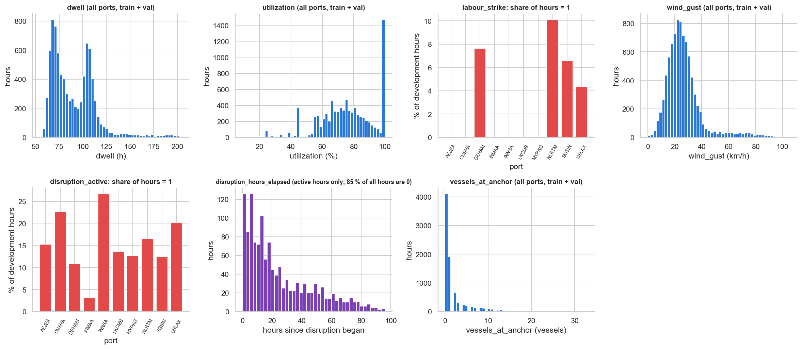

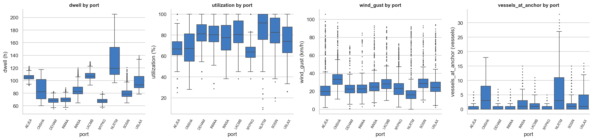

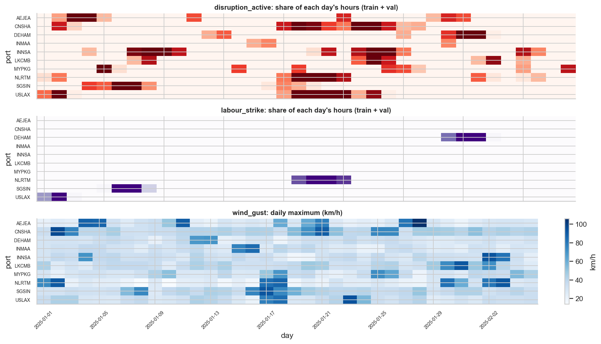

## 6. Feature–target relationships

These use the 7885 development windows. Each feature is taken at hour t (the last input step) against dwell at t+1. Measures:
- **Pooled** correlation, which is dominated by port levels.
- **Within-port** correlation, with each port's mean removed.
- **Partial** correlation within port, controlling for (a) dwell at hour t and (b) the window's EWMA, which is the information a smoothing baseline already has.

| Feature at t | Pearson (pooled) | Spearman (pooled) | Pearson (within port) | Partial | dwell(t) | **Partial | window EWMA** | Partial | EWMA, port range |
|---|---|---|---|---|---|---|
| dwell | 0.97 | 0.92 | 0.90 | – | -0.02 | -0.05 to 0.14 |
| utilization | 0.03 | 0.06 | -0.06 | -0.04 | -0.20 | -0.37 to -0.06 |
| labour_strike | 0.17 | 0.10 | 0.19 | 0.06 | 0.12 | 0.06 to 0.34 |
| wind_gust | -0.00 | -0.02 | 0.08 | 0.04 | 0.09 | 0.07 to 0.19 |
| disruption_active | 0.17 | 0.19 | 0.22 | 0.08 | 0.18 | 0.05 to 0.35 |
| disruption_hours_elapsed | 0.24 | 0.20 | 0.35 | 0.10 | 0.15 | 0.05 to 0.33 |
| vessels_at_anchor | 0.68 | 0.44 | 0.85 | 0.38 | 0.11 | 0.06 to 0.14 |

**Reading the table:**
- **Dwell history.** It is almost perfectly correlated with the target (within port 0.90), but once the window EWMA is known, the current hour adds nothing (-0.02). The last single hour is mostly noise.
- **Vessels at anchor** looks strong raw (within port 0.85), and strong given the last hour (0.38). But it falls to 0.11 given the window EWMA.
  - It is mainly a second, noisy view of the same backlog level.
  - Its value fades within about 2 h of lag (`E2_lagged_partial_correlations.png`).
  - Most of its raw correlation exists because both variables move with the backlog.
- **Utilization** has no raw correlation (within port -0.06), but the largest partial correlation given the EWMA (-0.20; negative at every port, -0.37 to -0.06).
  - Low throughput relative to capacity, with dwell held fixed, precedes higher dwell, which is consistent with a capacity cut building a backlog.
  - The signal is persistent across all 12 lags.
  - **This is the clearest case of a feature that is useful only in combination with dwell history.**
- **Disruption state** is positive at every port (0.05 to 0.35).
  - Next-hour dwell exceeds the EWMA by 1.70 h on average during disruptions, against -0.27 h otherwise (p = 1.94e-46).
  - The excess grows with time since onset: 0 (none): -0.27 h, 1-6: 1.39 h, 7-24: 1.77 h, 25-48: 1.62 h, >48: 2.14 h.
  - The EWMA lags rising episodes, and the disruption features can anticipate that.
- **Labour strike** shows an excess of 2.78 h over the EWMA (n = 220 windows).
  - The partial r ranges from 0.06 to 0.34 at the 4 ports with strikes.
  - The estimate rests on very few events.
- **Wind gusts** are weak but consistently positive at every port (partial 0.07 to 0.19).

**Caveats:**
- Per-port intervals that assume independent windows are too narrow, because windows overlap and share episodes.
- The synthetic generator builds dwell from a backlog driven by capacity cuts (disruptions, strikes, high gusts). These relationships are therefore partly properties of the simulator, not evidence about real ports.
- Nothing here is causal.

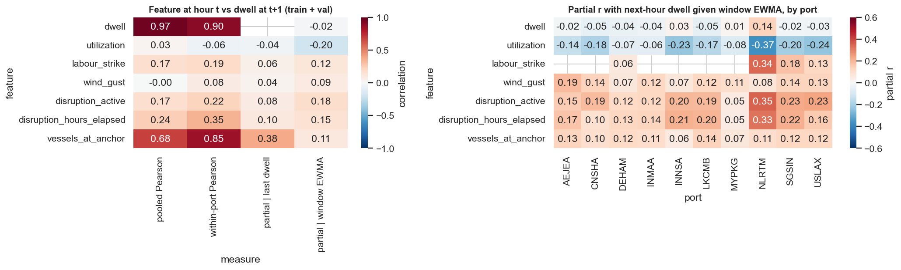

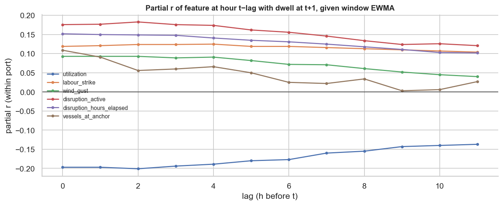

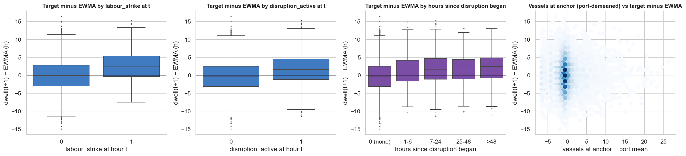

## 7. Reconstruction and data-quality sensitivity

|  | Train | Validation | Test (descriptive) |
|---|---|---|---|
| Kept windows with ≥ 1 reconstructed dwell input | 41.8 % | 47.9 % | 42.0 % |
| Kept windows with any reconstructed input cell | 74.9 % | 75.6 % | 73.4 % |

| Port | Recon. dwell hours: train | val | test | Windows affected: train | val | test |
|---|---|---|---|---|---|---|
| AEJEA | 5.1 % | 4.0 % | 4.0 % | 45 % | 39 % | 41 % |
| CNSHA | 5.1 % | 3.3 % | 6.0 % | 47 % | 38 % | 53 % |
| DEHAM | 4.3 % | 2.7 % | 4.7 % | 40 % | 32 % | 59 % |
| INMAA | 4.4 % | 4.0 % | 4.0 % | 45 % | 45 % | 41 % |
| INNSA | 3.9 % | 4.7 % | 8.0 % | 38 % | 46 % | 46 % |
| LKCMB | 4.6 % | 4.7 % | 4.0 % | 43 % | 47 % | 40 % |
| MYPKG | 4.0 % | 8.0 % | 2.0 % | 33 % | 62 % | 27 % |
| NLRTM | 4.7 % | 4.7 % | 6.7 % | 46 % | 45 % | 57 % |
| SGSIN | 4.7 % | 7.3 % | 2.7 % | 42 % | 48 % | 31 % |
| USLAX | 3.9 % | 10.0 % | 2.0 % | 38 % | 80 % | 27 % |

**Concentration:**
- Reconstructed dwell hours are spread evenly across ports (χ² p = 0.978).
- They are also spread evenly across days (p = 0.141; at most 19 per day across all ports).
- USLAX's validation period is an exception: 10 % of hours are reconstructed, so 80 % of its validation windows contain one.

**Do reconstructed values look different?**
- Relative to the median of observed neighbouring hours (±6 h), reconstructed values deviate by -0.26 ± 4.20 h.
- Observed values deviate by 0.02 ± 4.22 h.
- KS p = 0.235 and Levene p = 0.857: **no detectable difference in level or spread.**

**Does target behaviour differ?** Windows with reconstructed dwell inputs have the same next-hour EWMA error:
- With reconstructed inputs: RMSE 4.352 h.
- All inputs observed: 4.295 h.
- p = 0.65.
- This holds even when hour t itself is reconstructed: 4.463 vs 4.312 h, p = 0.908.

**Conclusion:**
- Reconstruction is unlikely to materially affect learning or evaluation.
- Keep the `dwell_reconstructed` channel. It is cheap, and the fill method is still undocumented.
- Run one ablation without it, rather than removing data.

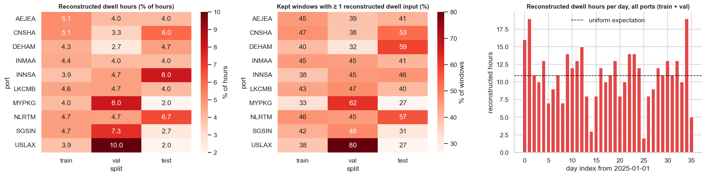

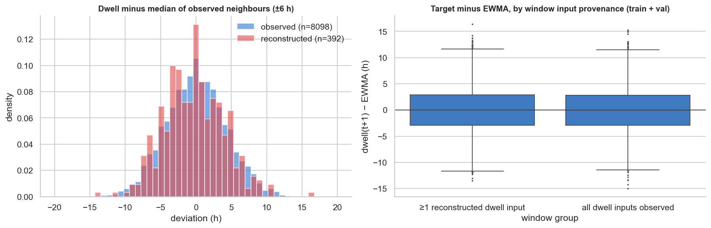

## 8. Port-level comparison

| Port | Train windows | Target mean (h) | Target SD (h) | Noise SD (h) | Signal share | ACF 12 | Disruption hours | Strike hours | Anchor mean | Util. mean (%) | Util. at 100 | Recon. dwell |
|---|---|---|---|---|---|---|---|---|---|---|---|---|
| AEJEA | 653 | 105.6 | 4.6 | 3.83 | 30 % | 0.15 | 15.3 % | 0.0 % | 0.64 | 67.7 | 7.8 % | 4.94 % |
| CNSHA | 653 | 82.5 | 15.3 | 4.04 | 93 % | 0.93 | 22.6 % | 0.0 % | 4.21 | 69.6 | 13.5 % | 4.82 % |
| DEHAM | 659 | 68.5 | 4.4 | 3.88 | 22 % | 0.19 | 10.8 % | 7.6 % | 0.62 | 81.6 | 10.0 % | 4.00 % |
| INMAA | 658 | 70.1 | 5.0 | 3.94 | 36 % | 0.27 | 3.2 % | 0.0 % | 0.59 | 80.5 | 6.0 % | 4.35 % |
| INNSA | 663 | 85.7 | 10.1 | 3.55 | 87 % | 0.81 | 26.7 % | 0.0 % | 1.77 | 78.1 | 20.6 % | 4.00 % |
| LKCMB | 656 | 107.3 | 6.1 | 3.95 | 58 % | 0.58 | 13.6 % | 0.0 % | 1.19 | 80.8 | 20.5 % | 4.59 % |
| MYPKG | 661 | 67.8 | 4.1 | 3.82 | 11 % | 0.06 | 12.7 % | 0.0 % | 0.43 | 63.8 | 1.3 % | 4.71 % |
| NLRTM | 657 | 133.0 | 31.5 | 3.54 | 99 % | 0.96 | 16.5 % | 10.1 % | 6.65 | 81.7 | 41.5 % | 4.71 % |
| SGSIN | 657 | 82.4 | 10.8 | 4.35 | 83 % | 0.82 | 12.5 % | 6.6 % | 1.62 | 81.1 | 23.4 % | 5.18 % |
| USLAX | 662 | 100.7 | 13.9 | 3.83 | 92 % | 0.90 | 20.1 % | 4.4 % | 2.66 | 74.3 | 23.5 % | 4.94 % |

**Window counts:** no port dominates. Each port contributes ≈ 10 % of windows.

**Target variance is far less balanced:**
- NLRTM holds 47.6 % of the pooled sum of squares.
- **Global scaling of dwell would hide the quiet ports.** A per-port SD of 4 h would be about 0.2 global SDs, and an error in hours would be dominated by NLRTM.
- The dataset's per-port z-scaling avoids that, but it has the reverse effect:
  - At MYPKG, DEHAM, AEJEA and INMAA most of the z-scaled variance is irreducible noise.
  - At NLRTM, CNSHA and USLAX the noise is only about 0.1–0.3 z-units.
- The ports fall into two groups that behave differently enough to make **per-port evaluation essential:**
  - **High-signal ports** (NLRTM, USLAX, CNSHA, INNSA, SGSIN): long episodes and high ACF. Here an LSTM can beat the EWMA.
  - **Noise-dominated ports** (MYPKG, DEHAM, AEJEA, INMAA): ACF ≤ 0.3. No model can do much better than a mean.

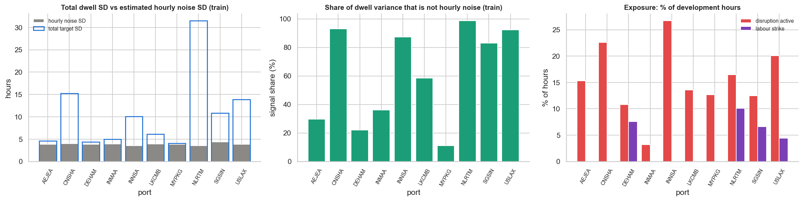

## 9. Distribution shift

### Train → validation (development; usable for decisions)

Values are hourly, in original units. SMD = (validation mean − train mean) / train SD, computed within port.

| Feature | Train mean | Val mean | KS | KS p | Mean \|per-port SMD\| |
|---|---|---|---|---|---|
| dwell | 90.25 | 90.93 | 0.051 | 0.00298 | 0.45 |
| utilization | 75.95 | 75.76 | 0.052 | 0.00274 | 0.22 |
| labour_strike | 0.03 | 0.01 | 0.018 | 0.819 | 0.31 |
| wind_gust | 26.32 | 27.92 | 0.055 | 0.00104 | 0.57 |
| disruption_active | 0.17 | 0.08 | 0.086 | 2.33e-08 | 0.31 |
| disruption_hours_elapsed | 4.35 | 1.44 | 0.085 | 2.68e-08 | 0.35 |
| vessels_at_anchor | 2.00 | 2.20 | 0.069 | 1.27e-05 | 0.48 |

**Target shift:**
- The pooled mean is almost unchanged.
- By port, CNSHA (+1.34 SD; the Spring-Festival backlog plateau) and LKCMB (+0.93) are higher, while USLAX (−0.80) and SGSIN (−0.59) are lower.
- The level-shift ports are the high-signal ports, so validation RMSE will depend on how well the model tracks episode onsets and decays.

**Covariate shift:**
- Disruption hours halve (16.9 % → 8.3 %).
- Strike hours fall (3.2 % → 1.4 %). In validation they occur only at DEHAM.
- Gusts are higher at INNSA (+1.2 SD) and LKCMB (+1.8 SD).

**Implication:** validation contains few disruption examples. Early stopping on validation RMSE will mostly reward calm-period accuracy. Monitor validation error on disruption hours separately.

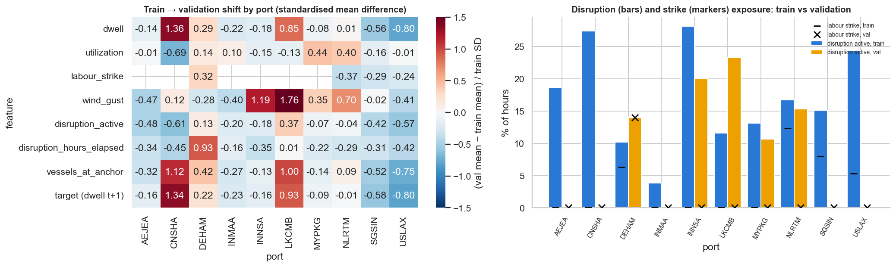

### Test period (descriptive only; not used for any decision)

- The target is lower than in training: 90.3 → 86.0 h pooled.
  - The scaled `y` mean is -0.21.
  - NLRTM, USLAX and SGSIN are 0.6–0.7 SD lower. MYPKG is 1.1 SD higher (a test-period strike and disruption).
- Strike hours rise to 8.5 %.
  - Test strikes occur at **INNSA, MYPKG** (34 %, 38 % of their test hours) and NLRTM.
  - **INNSA and MYPKG have no strike hours in development data.**
- Vessels at anchor fall (2.00 → 0.94) and gusts are lower.
- **Caveat:** test performance will partly measure extrapolation of the strike effect to unseen ports, and accuracy in a calmer regime.

## 10. Important observations

1. **Most next-hour variation is irreducible.** The noise SD of about 3.9 h is close to the EWMA RMSE of 4.30 h (validation) and 4.23 h (test).
2. **Signal lives in episodes at five ports.** Elsewhere dwell is near-constant plus noise.
3. **Operational features matter only conditionally.** Utilization and disruption state carry information *beyond* recent dwell, while their raw correlations are weak or misleading. Vessels at anchor is the reverse: strong raw correlation, little extra information.
4. **Strike evidence is thin,** and its test-period distribution differs in kind: new ports.
5. **Reconstructed inputs are statistically indistinguishable** from observed ones on every check made.
6. **The dataset passes all structural checks.**

## 11. Limitations

- **The data is synthetic.** The dwell process (port base level, backlog from capacity cuts, independent hourly noise) is simple, and the relationships found are properties of the simulator. None of this transfers to real ports without re-analysis.
- **Coverage is short:** 850 development hours (≈ 5 weeks) per port, with one Spring Festival and 42 development disruption episodes. Weekly and seasonal structure cannot be assessed.
- **Uncertainty is understated.** Overlapping windows and shared episodes mean the naive p-values and intervals here overstate certainty, especially for per-port strike estimates.
- **The noise decomposition is approximate.** It assumes independent hourly noise on a smooth level, which fits every port well (lag-1 ACF of Δ ≈ −0.5) but is approximate during sharp episode onsets.
- **Partial correlations are linear and pairwise.** They do not capture interactions, for example utilization × disruption.
- **Some provenance is unknown.** The reconstruction method behind the filled values is undocumented. They are statistically indistinguishable from observations, but are still not observations.

## 12. Recommendations for the DL Engineer

1. Judge every model against EWMA (alpha 0.2) on the same test windows, in hours, overall and per port; the attainable gain is small (hourly noise SD 3.5–4.4 h vs EWMA RMSE 4.30 h on validation). *(evidence: strong)*
2. Keep the 12-hour window and a small model (1 recurrent layer, 16–64 units, dropout, early stopping on validation RMSE). Do not add depth, attention or graph structure without validation evidence. *(evidence: strong)*
3. Report errors separately for disruption / strike hours vs normal hours and for high-signal ports (NLRTM, USLAX, CNSHA, INNSA, SGSIN) vs noise-dominated ports (MYPKG, DEHAM, AEJEA, INMAA). *(evidence: strong)*
4. Treat labour_strike as fragile: only 4 strike episodes at 4 ports in train + val, while the test period contains strikes at INNSA and MYPKG, which never strike in development data. Run an ablation without it. *(evidence: strong)*
5. Use the default 8-channel loader input (with dwell_reconstructed); reconstruction showed no measurable effect, so a 7-channel ablation is a check, not a requirement. Use a port embedding or per-port reporting; keep per-port dwell scaling and compute the loss in scaled units but evaluate in hours. *(evidence: moderate)*

Further practical points:
- **Splits and normalisation:**
  - Do not reshuffle across splits, and do not refit scalers.
  - Shuffle training windows within the training split only.
  - Use the saved per-port statistics. Global normalisation of dwell is not recommended, because it would mask the quiet ports.
- **Loss and evaluation units:**
  - Optimise MSE on the scaled target `y`, but select and report models by RMSE in hours (`dataset.to_hours`).
  - Optionally also report a port-balanced RMSE, since NLRTM dominates pooled hour-scale error.
- **Repeat runs.** Use at least 5 seeds and report mean ± SD. Differences below about 0.05 h RMSE are not meaningful at this sample size.
- **Ablations worth running:** without `labour_strike`, without `vessels_at_anchor`, and without the `dwell_reconstructed` channel.

## Implications for LSTM Architecture and Training

| # | Question | Answer | Evidence |
|---|---|---|---|
| 1 | Is a 12-hour window reasonable? | **Yes.** 6–12 h trailing means give the best smoothing error; 24 h and 48 h are worse; hours t−47…t−12 add nothing given the window (partial r -0.07). | Strong |
| 2 | Is there enough temporal signal to justify an LSTM? | **Partly.** The history is strongly autocorrelated at 5 ports, but its usable part is captured by exponential smoothing (EWMA 4.30 h vs noise ≈ 3.9 h). An LSTM is justified only as a way to combine history with operational signals non-linearly; it must beat EWMA to be kept. | Strong (headroom); moderate (whether an LSTM captures it) |
| 3 | Most informative operational features? | Utilization (-0.20), disruption active (0.18) and elapsed (0.15), strike (0.12), vessels at anchor (0.11), gusts (0.09); partial r given window EWMA. | Moderate (consistent signs across ports, modest size) |
| 4 | Nearly constant or unhelpful features? | None is constant. `labour_strike` is the most fragile (4 development episodes, 4 ports). Vessels at anchor is largely redundant with dwell history. Keep both, and ablate. | Moderate |
| 5 | Strong port-specific differences? | **Yes.** Ports explain 71 % of target variance; signal share ranges 11 %–99 %. | Strong |
| 6 | Global or per-port scaling? | Keep **per-port** dwell and anchor scaling (already in the dataset). Global scaling would let NLRTM dominate. Add a port embedding (`port_index`) so the model can learn port-specific noise and dynamics. | Strong (scaling); weak (embedding benefit untested) |
| 7 | Could reconstructed inputs affect performance? | **Unlikely.** No difference in value distribution (KS p 0.235) or baseline error (p 0.65). Keep the flag channel as a safeguard. | Moderate |
| 8 | What to be careful about? | Overfitting noise (most variance is irreducible). Early stopping on a calm validation period. Few strike and disruption examples. Reporting gains below seed-to-seed variation. Never using test windows for any choice. | Strong |
| 9 | Essential evaluation breakdowns? | Per port; high-signal vs noise-dominated ports; disruption-active vs normal hours; strike vs non-strike (noting new strike ports in test); windows with vs without reconstructed inputs; always side by side with EWMA, the 12 h mean and persistence on identical windows. | Strong |

**Evidence summary:**
- **Strong:**
  - Hourly noise of about 4 h dominates next-hour variation.
  - A 12 h window is sufficient.
  - Port heterogeneity is large, so per-port scaling and evaluation are needed.
  - Disruption and utilization carry information beyond dwell history.
  - The dataset is structurally valid.
- **Moderate:**
  - Ranking of operational features.
  - Reconstruction has no material effect.
  - Vessels at anchor is largely redundant.
  - Validation is calmer than training.
- **Weak or inconclusive:**
  - Size and generality of the strike effect.
  - Diurnal effect: detectable, but about 1 h in amplitude and explaining 0.6 % of variance.
  - Any weekly pattern.
  - Whether a port embedding helps.
  - Whether non-linear models extract more than linear partial correlations suggest.

**Recommended model input:** `dataset.load_split(split)` gives **`[N, 12, 8]`** (train N = 6579, validation N = 1306, test N = 1318), plus `port_index` for an embedding. The target is `y` `[N]`, scaled, with `y_hours` for evaluation.
For a 1D CNN, transpose to `[N, 8, 12]`.
