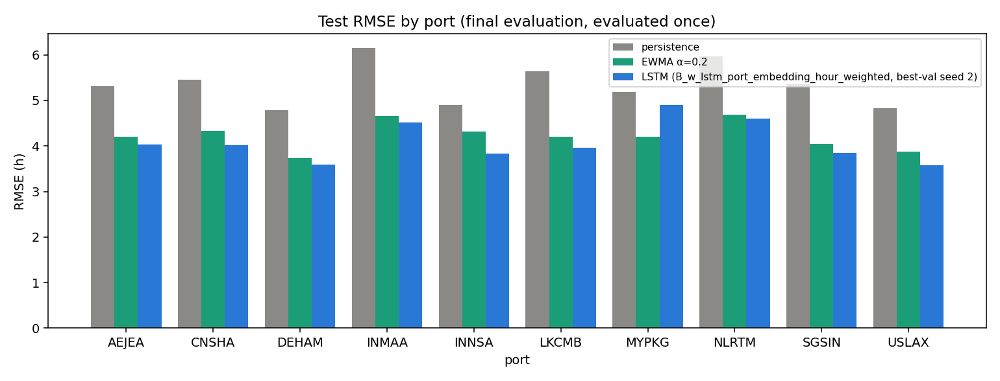
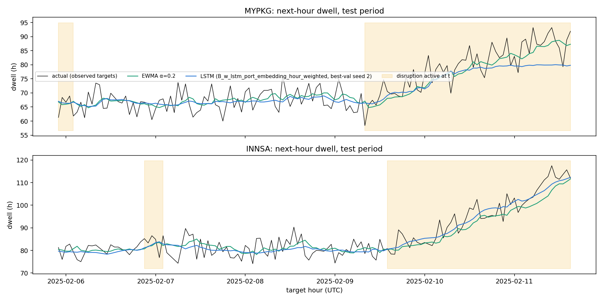

# CargoMind Stage 02 — LSTM Evaluation Report

**Model evaluated:** `DL/DL/artifacts/lstm_best.pt`, configuration **B_w**:
- 1-layer LSTM, 32 units;
- 4-d port embedding;
- 8 input channels;
- hour-weighted MSE.

It was selected on validation by a pre-registered rule; see [DL_training_report.md](../../DL/reports/DL_training_report.md).

**Test discipline:**
- The test split was evaluated **once** after `selection.json` was written (`DL/DL/artifacts/test_evaluation_log.json`: 1 invocation, 2026-11-01 17:29 UTC).
- Only the selected configuration was evaluated: its designated checkpoint plus its 5 seeds, for spread.
- Ablations, C_w and the GRU were **not** evaluated on test.
- Nothing measured here was used to change the model.

All metrics are in hours, on the same 1,318 test windows the baselines use. The baseline values were recomputed from the per-window predictions in `windows.csv` and checked against `baseline_metrics.csv`; they were not modified. The data is synthetic, so no real-world performance is implied.

## 1. Headline test results

Source: `DL/Evaluation/results/evaluation/test_headline.csv`.

| Model | MAE (h) | RMSE (h) | R² | Port-balanced RMSE (h) |
|---|---|---|---|---|
| Repeat last hour (persistence) | 4.293 | 5.372 | 0.895 | 5.356 |
| 12-hour mean | 3.447 | 4.304 | 0.933 | 4.293 |
| EWMA α = 0.2 | 3.411 | 4.234 | 0.935 | 4.227 |
| **LSTM B_w, seed 2 (`lstm_best.pt`)** | **3.268** | **4.108** | **0.939** | **4.086** |
| LSTM B_w, mean of 5 seeds | 3.300 | 4.143 | 0.938 | 4.121 |
| LSTM B_w, SD over 5 seeds | 0.049 | 0.058 | 0.002 | 0.055 |

- **Against EWMA:** RMSE −0.126 h (−3.0 %) and MAE −0.143 h (−4.2 %) for the designated checkpoint. The 5-seed mean is −0.091 h.
- **By seed:** test RMSE is 4.094, 4.108, 4.118, 4.161 and 4.237 h. Four seeds beat EWMA; seed 4, the seed that stopped at epoch 2, ties it (+0.002).
- **R² is high for every model** (≥ 0.89) only because port levels differ so much. It says little about forecasting skill.

**Paired block bootstrap**, RMSE(LSTM) − RMSE(EWMA), 2,000 resamples (`test_paired_bootstrap_vs_ewma.json`):

| Checkpoint | Day blocks (7) | Port-day blocks (70) |
|---|---|---|
| Seed 2 (designated) | −0.126 [−0.178, −0.041] | −0.126 [−0.271, +0.068] |
| Seed 0 | −0.073 [−0.123, −0.020] | −0.073 [−0.226, +0.111] |
| Seed 1 | −0.116 [−0.172, −0.029] | −0.116 [−0.266, +0.083] |
| Seed 3 | −0.141 [−0.190, −0.071] | −0.141 [−0.269, +0.025] |
| Seed 4 | +0.002 [−0.147, +0.237] | +0.002 [−0.171, +0.257] |

- **The two resampling schemes disagree.** With only 7 test days, the day-block interval is too coarse to trust. The port-day interval shows that the gain depends on which port-episodes are drawn.
- **Conclusion:** the improvement is **consistent in sign but not statistically secure.**



## 2. Per-port results

Test, observed targets; designated checkpoint vs baselines (`test_subgroups.csv`).

| Port | n | EWMA RMSE | LSTM RMSE | Δ RMSE | EWMA MAE | LSTM MAE | Seed range (RMSE) | Group |
|---|---|---|---|---|---|---|---|---|
| INNSA | 128 | 4.318 | 3.828 | **−0.490** | 3.454 | 3.177 | 3.83 – 4.10 | high-signal |
| CNSHA | 129 | 4.328 | 4.012 | −0.317 | 3.504 | 3.109 | 4.01 – 4.22 | high-signal |
| USLAX | 135 | 3.875 | 3.577 | −0.298 | 3.142 | 2.959 | 3.55 – 3.60 | high-signal |
| LKCMB | 132 | 4.203 | 3.967 | −0.235 | 3.434 | 3.242 | 3.95 – 4.00 | intermediate |
| SGSIN | 134 | 4.045 | 3.843 | −0.202 | 3.197 | 2.993 | 3.84 – 3.99 | high-signal |
| AEJEA | 133 | 4.207 | 4.034 | −0.173 | 3.506 | 3.354 | 4.00 – 4.07 | noise-dominated |
| INMAA | 132 | 4.663 | 4.510 | −0.153 | 3.786 | 3.596 | 4.45 – 4.51 | noise-dominated |
| DEHAM | 131 | 3.729 | 3.585 | −0.144 | 2.936 | 2.789 | 3.57 – 3.77 | noise-dominated |
| NLRTM | 129 | 4.692 | 4.607 | −0.084 | 3.687 | 3.583 | 4.57 – 4.91 | high-signal |
| **MYPKG** | 135 | 4.208 | 4.896 | **+0.688** | 3.477 | 3.867 | 4.72 – 5.26 | noise-dominated |
| High-signal ports | 655 | 4.256 | 3.984 | −0.272 | | | 3.98 – 4.15 | |
| Noise-dominated ports | 531 | 4.215 | 4.289 | +0.074 | | | 4.23 – 4.41 | |

**Ports that benefited:**
- **The high-signal ports benefited most.** INNSA, CNSHA and USLAX gained 0.3–0.5 h.
- **The noise-dominated ports also improved by about 0.15 h,** except MYPKG. This mostly reflects better smoothing of hourly noise than α = 0.2 gives (an LSTM can learn a port-appropriate smoothing). It is not anticipation of events.
- **NLRTM, the port with the largest dwell variance, gained least** (−0.08 h), and its seed range straddles the EWMA.

## 3. Disruption, strike and reconstruction subgroups

Status is taken at forecast hour t, which is known at prediction time.

| Subgroup | n | EWMA RMSE | LSTM RMSE | Δ | 5-seed range |
|---|---|---|---|---|---|
| Normal hours (no disruption) | 1,168 | 4.168 | 4.002 | −0.165 | 4.00 – 4.07 |
| Disruption active | 150 | 4.720 | 4.854 | +0.134 | 4.73 – 5.49 |
| Disruption 1–6 h old | 34 | 4.367 | 3.956 | **−0.411** | 3.90 – 4.01 |
| Disruption 7–24 h old | 57 | 4.855 | 4.117 | **−0.738** | 4.04 – 4.70 |
| Disruption > 24 h old | 54 | 4.729 | 5.939 | **+1.210** | 5.72 – 6.93 |
| Labour strike | 118 | 4.808 | 5.034 | +0.226 | 4.89 – 5.80 |
| No strike | 1,200 | 4.174 | 4.006 | −0.168 | 4.01 – 4.08 |
| ≥ 1 reconstructed dwell input | 553 | 4.194 | 4.015 | −0.179 | 4.00 – 4.21 |
| All dwell inputs observed | 765 | 4.263 | 4.174 | −0.089 | 4.16 – 4.26 |

All disruption subgroups have at least 34 windows, but they come from only a handful of episodes (MYPKG and INNSA dominate the test disruptions), so treat them as case studies, not estimates.

### Did the model learn to anticipate disruptions?

**Partly.** In the first 24 hours of an episode the LSTM is far better than EWMA (−0.41 h and −0.74 h). EWMA lags a rising backlog by construction, while the LSTM reacts to the disruption, utilization and strike channels and moves ahead of it.

`DL/Evaluation/figures/test_disruption_ports_timeseries.png` shows both sides:
- **INNSA:** during the 10–11 Feb build-up the LSTM leads the rise and stays above the lagging EWMA throughout.
- **MYPKG (the failure):** the LSTM also leads at first, then **flattens at about 80 h** while actual dwell keeps rising past 90 h. EWMA follows the rise.

**Why it fails at MYPKG:**
- MYPKG's training-period dwell SD is about 4 h around a mean of 68 h, so 90 h is about +5.5 SD in the per-port z units the model works in. That is far outside its training range.
- The LSTM's bounded hidden state, followed by a linear head, cannot extrapolate there. EWMA, being linear in its inputs, can.
- The episode is also a **strike at a port that never struck in development data** (the EDA's warning).
- This one episode explains MYPKG's +0.69 h, the +1.21 h in disruptions older than 24 h, and most of the +0.23 h on strike hours.



### Reconstructed inputs

Windows with reconstructed dwell inputs are *not* harder. The LSTM's advantage over EWMA is in fact slightly larger there (−0.18 h vs −0.09 h). This is consistent with the EDA, and no reconstruction effect is visible.

## 4. Answers

| Question | Answer |
|---|---|
| Did the LSTM beat EWMA? | **On test, modestly:** RMSE 4.108 vs 4.234 h (−3.0 %), MAE −4.2 %. **On validation, not by a practically meaningful margin:** 4.254 vs 4.296 h (−0.042 h, inside the 0.05 h tie band). |
| Consistent across seeds? | **Mostly.** All 5 seeds beat EWMA on validation; 4 of 5 on test (the fifth ties). The seed SD of 0.058 h on test is about half the gain. |
| Did the port embedding help? | **No meaningful effect:** −0.027 h on validation (B_w vs A_w), inside the tolerance. |
| Which features contributed? | **No single operational feature is individually necessary;** every one-factor ablation is within ±0.05 h on validation. **Jointly they matter during episodes:** dwell history alone is +0.02 h overall, +0.08 h on disruption hours and +0.39 h on disruptions 7–24 h old (n = 44). On disruptions 1–6 h old (n = 36), dwell history alone was actually better (validation). Wind gust appears harmful on validation (−0.042 h when removed), consistent with its covariate shift. The reconstruction flag and vessels at anchor are neutral. |
| Did it learn to anticipate disruptions? | **In the first 24 h of an episode, yes** (−0.41 to −0.74 h vs EWMA on test). **In long episodes outside the training range, no:** it saturates and is much worse than EWMA (+1.21 h). |
| Which ports benefited? | INNSA, CNSHA, USLAX (−0.3 to −0.5 h), then LKCMB and SGSIN. |
| Which stayed noise-dominated? | AEJEA, DEHAM, INMAA: about −0.15 h, from better smoothing rather than event anticipation. NLRTM gained little. MYPKG got worse. |
| Practically meaningful? | **Marginal.** A 0.13 h (about 8 minutes) RMSE gain on a 4.2 h error, against a noise floor of about 3.9 h. That closes roughly a third of the EWMA-to-noise gap on test, but not on validation, and the port-day bootstrap interval includes zero. |
| Use it in CargoMind? | **Not as the primary forecaster yet** (see section 6). |

## 5. Limitations

- **Data:** synthetic, 41.7 days, 10 ports. The dwell process (level + backlog + white noise) is simple, and nothing here transfers to real ports.
- **One short test period:** 7 target days, about 130 windows per port, and very few disruption and strike episodes. Subgroup estimates are case studies.
- **The selection rule's simplicity order** placed C_w (EWMA residual) after B_w. C_w was better on validation (4.212 vs 4.254 h) and avoids the extrapolation failure by construction, but the rule was honoured as written.
- **Strike and episode extrapolation:** per-port z-scaling plus a bounded recurrent state limits how far the model can move beyond levels seen per port. This is a structural limitation for rare, extreme episodes, which are exactly the operationally important cases.
- **The test set is now spent.** Any follow-up model choice (C_w, GRU, dropping wind gust) needs new held-out data, for example a rolling-origin evaluation or a later synthetic period. It must not be re-scored on this test split.

## 6. Recommendation

**Retain the LSTM as a research result and a challenger. Do not deploy it as CargoMind's primary dwell forecaster.**

1. **Keep EWMA (α = 0.2) as the production forecast for now.** The LSTM's average gain is small and not statistically secure. Its failure mode — under-forecasting dwell during a long, unprecedented backlog — is the most costly kind of error for a bottleneck-warning system.
2. **Next candidate: C_w (EWMA + LSTM correction) with a GRU cell.** On validation it is the best LSTM-family variant (4.212 h, seed SD 0.008), and the GRU is best overall (4.202 h). C_w reduces to EWMA when its correction is zero, so it cannot fall below EWMA by failing to extrapolate. Evaluate it on **fresh held-out data** with the same per-port, episode and strike breakdowns.
3. **Investigate wind gust under covariate shift** before keeping it as an input.
4. **Report forecasts with episode context.** Any dashboard use should show per-port error and flag hours where dwell is outside the port's training range.

## 7. Artifacts and commands

| Path | Contents |
|---|---|
| `DL/DL/artifacts/lstm_best.pt` | Selected checkpoint: weights, model config, input channel list, target definition, SHA-256 references to `feature_schema.json`, `scalers.json` and `split_metadata.json` |
| `DL/DL/artifacts/lstm_config.json` | Model and training config, port-embedding config and port order, best epoch, inference snippet |
| `DL/DL/artifacts/selection.json`, `selection_round1.json` | Validation-based decisions |
| `DL/DL/artifacts/experiment_metadata.json` | Environment, seeds, experiment definitions, dataset hashes |
| `DL/DL/artifacts/test_evaluation_log.json` | Every test invocation (one) |
| `DL/DL/artifacts/runs/<experiment>/seed_<s>.pt` | All 65 trained checkpoints |
| `DL/DL/training/logs/<experiment>/seed_<s>.csv` | Per-epoch training objective, train / validation RMSE (h), validation scaled MSE, learning rate |
| `DL/DL/artifacts/experiment_results.csv` | One row per experiment × seed (validation metrics, best epoch, parameters) |
| `DL/Evaluation/results/evaluation/` | Test headline, subgroups, per-window predictions, bootstrap; validation diagnostics |
| `DL/Evaluation/figures/` | Training curves, seeds and ablations, test per-port RMSE, disruption time series |

**Loading the model for inference** (no training code imported):

```python
from dl.models import load_checkpoint
model, meta = load_checkpoint("DL/DL/artifacts/lstm_best.pt")   # raises if the dataset files changed
# x: [N, 12, 8] from cargomind_dl.dataset.load_split(...) with meta["input_channels"]; port_index: [N]
# hours = cargomind_dl.dataset.to_hours(model(x, port_index).detach().numpy(), port_index)
```

**Reproduce** (from the project root):

```
.venv/bin/python -m dl.training.run_experiments main
.venv/bin/python -m dl.training.run_experiments round2
.venv/bin/python -m dl.evaluation.evaluate test        # final evaluation (already run once; re-running appends to the log)
.venv/bin/python -m dl.training.run_experiments ablations
.venv/bin/python -m dl.training.run_experiments gru
```
