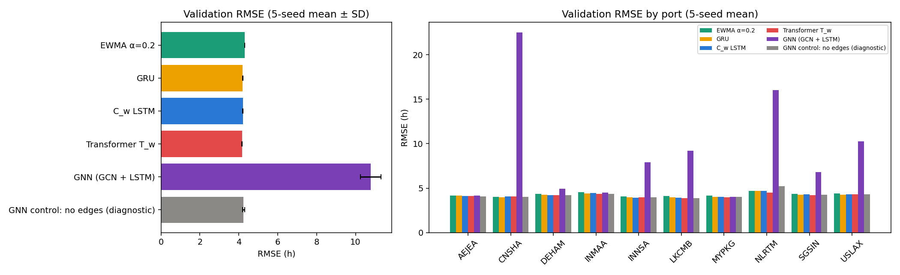

# CargoMind Stage 02 — GCN + LSTM Graph Experiment (supplementary)

**Summary.** A genuine graph neural network (graph convolution over the port network, followed by a per-port LSTM) was implemented and trained on the existing DL dataset.

- **Message passing works as designed.** It was verified by tests: changing one port's inputs changes its direct-route neighbours' forecasts and leaves non-neighbours' forecasts exactly unchanged.
- **The model forecasts badly.** Validation RMSE is **10.77 ± 0.53 h**, against **4.30 h for EWMA** and 4.16–4.21 h for the GRU, C_w LSTM and Transformer T_w.
- **The cause was isolated with a diagnostic control.** The same model and pipeline with the edges removed scores 4.25 h. The neighbour aggregation of a standard GCN on this dense port graph dilutes each port's own signal.

This is a supplementary experimental baseline. It is **not** a candidate forecaster and does not change the model designations (Transformer T_w leading research candidate, EWMA fallback). Implementing a GNN is not evidence that graph learning helps here; this experiment is evidence that, in this form, it hurts.

All results are validation-only. The test split was not loaded, and the data is synthetic.

---

## 1. Why graphs for port networks

Ports are connected by shipping routes, and congestion can propagate: vessels delayed at one port arrive late at the next, and disrupted hubs push cargo to alternatives. A GNN encodes the route network as a graph and lets each port's representation draw on its neighbours' states, so in principle it could learn such spill-overs.

The DL EDA had found **no measurable cross-port dependence** in this dataset:
- hourly dwell changes correlate at most |r| = 0.10 between ports (0.13 at lags 1–24 h);
- the median cross-port correlation of deviations from the 24-hour mean is 0.02.

The synthetic generator simulates each port's backlog independently. The experiment therefore tests whether a graph model can learn anything useful when the graph carries little signal.

## 2. Graph representation and adjacency

| Item | Choice |
|---|---|
| Nodes | The 10 ports, in the dataset's `port_index` order (AEJEA, CNSHA, DEHAM, INMAA, INNSA, LKCMB, MYPKG, NLRTM, SGSIN, USLAX), identical for every sample |
| Source | `ML/Dataset/Processed/port_network.csv` (90 routes: every ordered port pair once; 52 `direct`, 38 `transshipment`) |
| Edges | An **undirected edge if a direct route exists in either direction.** Direct routes are physical connections; the 52 directed routes include only 15 reciprocated pairs, and a symmetric GCN needs an undirected graph. |
| Transshipment routes | **Not** turned into edges: their legs are not routes in the table, and no edge is invented. 72 of their 76 legs already coincide with direct routes. |
| Resulting graph | **37 of 45 possible edges (density 0.82)**, node degrees 5–9. Missing pairs: AEJEA–NLRTM, CNSHA–INMAA, CNSHA–INNSA, INMAA–MYPKG, INMAA–NLRTM, INMAA–USLAX, INNSA–NLRTM, NLRTM–USLAX. |
| Normalisation | Â = D^-1/2 (A + I) D^-1/2, with self-loops added and D the degree matrix of A + I |
| Leakage | The graph uses only static network data, no targets or time-varying information. It is stored as a fixed buffer, not learned. |

Using all 90 routes would give a complete graph, in which the GCN reduces to an average over all ports. The direct-route graph is the sparsest graph the data supports, and it is still dense.

## 3. Architecture (`DL/DL/models/gnn.py`)

```
X [B, 12, 10, 8]
 └─ GCN at every hour (shared W, ReLU):   H_t = ReLU( Â · X_t · W + b )     W: 8 → 32        [B, 12, 10, 32]
 └─ per-port sequences (shared LSTM, hidden 32) over the 12 hours → final hidden state     [B·10, 32]
 └─ Dropout(0.1) → Linear(32 → 1)                                                          [B, 10]
```

| Component | Parameters |
|---|---|
| GCN (8×32 + 32) | 288 |
| LSTM (input 32, hidden 32) | 8,448 |
| Head (32 + 1) | 33 |
| **Total** | **8,769** (Transformer T_w 8,865; GRU 5,299; C_w 5,409) |

**Input:** `[batch, 12 hours, 10 ports, 8 channels]`, with the same 8 channels as every other DL model, including the dwell-reconstructed flag. **Output:** `[batch, 10]`, next-hour dwell per port as a per-port z-score, converted to hours with the dataset's inverse transform.

## 4. Dataset adaptation (`DL/DL/training/graph_data.py`)

The stored windows are per (port, hour). A graph snapshot needs all ten ports at the same hour, which the data supports exactly:
- **Inputs.** All ports share one complete hourly grid (hours 0–999; every one of the 988 candidate hours has all 10 ports). Each snapshot's inputs are built from `DL/Dataset/processed/hourly_panel.csv` with the dataset build's own transform (`cargomind_dl.sequences.transform`) and the saved `scalers.json`, plus the provenance flag.
- **Equivalence.** Every kept window inside a snapshot is **bit-identical** to the stored `X` for that window (tested; max difference 0.0).
- **Masked targets.** A port's target counts only if its (port, t) window was *kept* by the dataset build. Reconstructed targets and boundary-crossing windows remain excluded and are masked, never filled. Snapshots have 6–10 usable targets.
- **Splits.** The dataset's embargo rule is unchanged. Snapshots: train 688, validation 138, test 138 (not used). Masked targets: **6,579 / 1,306 / 1,318**, exactly the windows every other model uses.

## 5. Training (`DL/DL/training/gnn_trainer.py`)

The protocol is that of the hour-weighted models:
- Adam, lr 1e-3; gradient clipping 1.0; ReduceLROnPlateau (factor 0.5, patience 5).
- Early stopping (patience 15) and checkpoint selection on **validation RMSE in hours**.
- Seeds 0–4.
- Loss: MSE on the per-port z-scored target, weighted by port dwell variance (equals MSE in hours), averaged over masked targets only.
- Batch: 8 snapshots (about 76 windows; the other models use 64).

**No hyperparameter search was run.** The configuration is fixed. One **diagnostic control** was added: the identical model, data, loss and protocol with an **empty graph** (self-loops only), which removes neighbour mixing. It isolates the graph's effect and checks the pipeline. It is not a candidate model.

## 6. Validation results

Same 1,306 validation windows for every model; hours; 5-seed means. Source: `DL/Evaluation/results/gnn/validation_comparison.csv`.

| Model | Params | RMSE (mean ± SD) | MAE | Bias | Port-balanced RMSE | Δ vs EWMA |
|---|---|---|---|---|---|---|
| EWMA α = 0.2 | 0 | 4.296 | 3.446 | +0.11 | 4.291 | 0 |
| GRU | 5,299 | 4.202 ± 0.008 | 3.381 | −0.12 | 4.196 | −0.094 |
| C_w LSTM | 5,409 | 4.212 ± 0.008 | 3.390 | −0.12 | 4.205 | −0.085 |
| Transformer T_w | 8,865 | **4.162 ± 0.007** | **3.360** | −0.09 | 4.158 | −0.134 |
| **GNN (GCN + LSTM)** | 8,769 | **10.773 ± 0.531** | 7.773 | −0.72 | 9.029 | **+6.476** |
| GNN control: no edges (diagnostic) | 8,769 | 4.247 ± 0.053 | 3.411 | +0.05 | 4.231 | −0.050 |

**Seed-level GNN validation RMSE:** 10.97, 10.02, 10.87, 11.45, 10.55 h. The best epochs are 1–8: validation error is lowest almost immediately and then fluctuates. Even **training** RMSE is 8.1–9.3 h at the selected epochs, and never falls below 7.2 h in any epoch, against about 4.1 h for the other models and the control. The model cannot fit its training data, which points to an information bottleneck rather than overfitting.

**Per-port validation RMSE** (h, 5-seed means; `validation_per_port.csv`):

| Port | EWMA | GRU | C_w | T_w | **GNN** | Control (no edges) |
|---|---|---|---|---|---|---|
| AEJEA | 4.18 | 4.14 | 4.12 | 4.13 | 4.15 | 4.09 |
| CNSHA | 4.01 | 3.97 | 4.07 | 4.09 | **22.52** | 4.03 |
| DEHAM | 4.37 | 4.28 | 4.23 | 4.21 | 4.92 | 4.22 |
| INMAA | 4.54 | 4.40 | 4.44 | 4.34 | 4.50 | 4.37 |
| INNSA | 4.07 | 3.99 | 3.94 | 3.96 | **7.90** | 3.95 |
| LKCMB | 4.13 | 3.95 | 3.93 | 3.88 | **9.18** | 3.88 |
| MYPKG | 4.15 | 4.01 | 4.03 | 3.95 | 4.02 | 4.00 |
| NLRTM | 4.70 | 4.69 | 4.70 | 4.51 | **16.04** | 5.20 |
| SGSIN | 4.35 | 4.27 | 4.29 | 4.22 | **6.78** | 4.27 |
| USLAX | 4.42 | 4.26 | 4.32 | 4.29 | **10.27** | 4.31 |

**Disruption-active windows** (n = 102): GNN 10.10 h vs EWMA 4.38, T_w 3.89, GRU 4.12, C_w 4.14. The control scores 4.62 there.



## 7. Why the GNN fails: diagnosis

1. **Its own signal is diluted.** With self-loops and symmetric normalisation, a port's own features get weight 1/(degree + 1) in its aggregated representation: **10–17 %** on this graph (degrees 5–9). The other 83–90 % comes from neighbours. A standard GCN layer has no separate self (skip) path, so the LSTM never sees a port's own dwell history undiluted.
2. **This matters most where the signal is local.** Dwell here is a per-port level plus independent noise, with episodes driven by each port's own disruptions (EDA).
   - Quiet ports (AEJEA, MYPKG, INMAA) are near-constant anyway and stay at EWMA level.
   - Ports with their own backlog episodes fail badly. CNSHA's Spring-Festival plateau during validation is under-forecast by about 21 h, because its non-congested neighbours dominate its representation.
3. **The control confirms it.** Removing the edges, with everything else identical, recovers 4.25 h, so data adaptation, masking, loss and trainer are sound. Notably the control does *not* beat the existing models: graph structure aside, the GCN + LSTM is no better than an ordinary per-port LSTM on this data.

These are **model failures**, not statistical noise: the GNN is worse at 7 of 10 ports by 0.5–18 h, and consistently across seeds (SD 0.53 h).

## 8. Graph limitations

- **Small graph:** 10 nodes.
- **Dense graph:** 37 of 45 edges; the full route table is a complete graph. Neighbourhoods are almost global, so a GCN layer behaves like smoothing across the whole network.
- **No cross-port signal to exploit.** The EDA found none; the generator simulates ports independently. A graph model can at best learn to ignore its neighbours, and a standard GCN layer cannot.
- **Static, unweighted edges.** No route distance, frequency or capacity weights; no transit-time lags, which real propagation would follow.
- **Synthetic data.** Real port networks may show genuine spill-overs. This experiment says nothing about them.

## 9. Status and recommendation

- **The GNN is a supplementary experimental baseline, not a forecasting candidate.** It was not added to the inference registry. The research designations are unchanged: Transformer T_w leads, GRU and C_w are competitive alternatives, and EWMA is the operational fallback.
- **Implemented ≠ helpful.** The implementation is genuine (message passing verified), but the evidence shows graph learning, in this standard form on this graph, **degrades** forecasts.
- **If graph learning is revisited**, it should only be with evidence of cross-port dependence (for example, real data with route-lagged spill-overs). Natural architectural changes to *test* then would preserve each node's own representation:
  - a self/skip connection, or GraphSAGE-style concatenation of self and neighbour features;
  - edge weights and transit-time lags.

  None was tried here, by design.

## 10. Reproduce

```
.venv/bin/python -m unittest discover -s DL/Evaluation/tests      # includes 12 GNN tests
.venv/bin/python -m dl.training.gnn_trainer                       # GNN, 5 seeds (~25 s, CPU)
.venv/bin/python -m dl.training.gnn_trainer --control             # diagnostic control (no edges)
.venv/bin/python -m dl.evaluation.compare_gnn                     # validation comparison + figure
```

**Outputs:**

| Path | Contents |
|---|---|
| `DL/DL/artifacts/gnn/runs/{G_w_gcn_lstm_hour_weighted, G_w_control_no_edges}/seed_<s>.pt` | Checkpoints (`model_type: gnn`; loadable with `dl.models.load_checkpoint`) |
| `DL/DL/artifacts/gnn/experiment_results.csv` | One row per run |
| `DL/DL/training/logs/gnn/` | Per-epoch logs |
| `DL/Evaluation/results/gnn/` | Comparison tables |
| `DL/Evaluation/figures/gnn/` | Figure |
