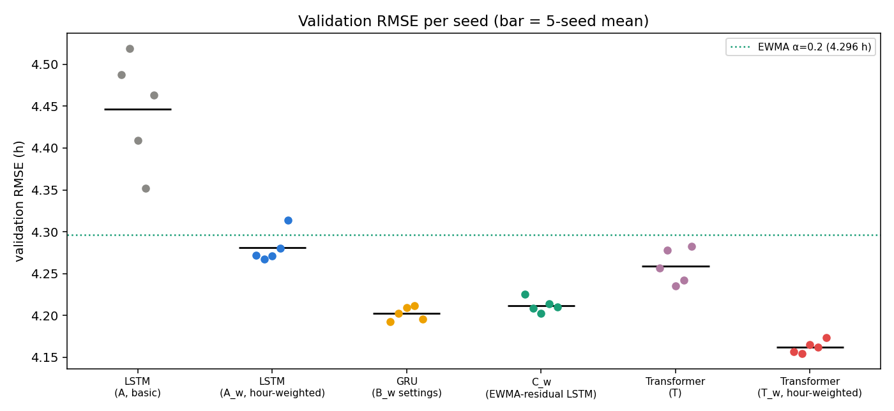
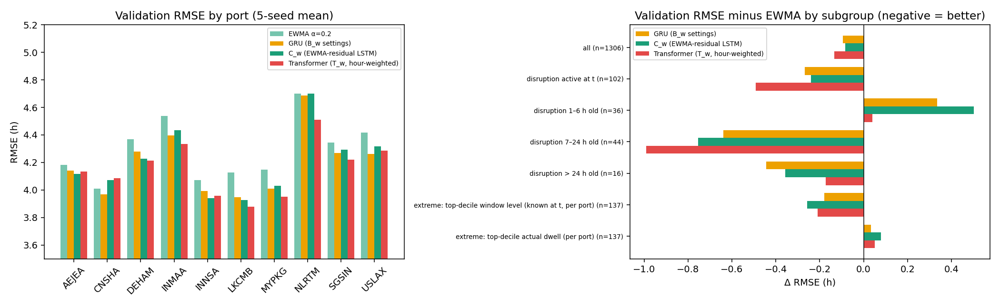

# CargoMind Stage 02 — Transformer Forecaster: Implementation and Validation Comparison

**Scope.** One small Transformer encoder was added to the existing pipeline and compared with the existing LSTM, GRU and C_w models and the three baselines.

**Data use.**
- **All comparisons use the validation split only.**
- The test split was not loaded for this work. It has already been examined by the earlier experiments and the independent audit, so it serves only as a diagnostic.
- No data was generated, and no dataset, split, existing checkpoint, log or report was modified.
- The data is synthetic.

Sources: `DL/DL/artifacts/transformer/` (results, comparison CSVs), `DL/DL/training/logs/transformer/`, `DL/Evaluation/figures/transformer/`.

## 1. Implementation

```
x [B, 12, 8] ─ Linear(8 → 32) ─ + fixed sinusoidal positional encoding (positions 0..11, oldest → newest)
             ─ TransformerEncoderLayer(d_model 32, nhead 4, dim_feedforward 64, dropout 0.1, batch_first) × 1
             ─ representation at the last position (hour t) ─ Linear(32 → 1) ─ ŷ [B]
```

- **Leakage.** Attention runs only over the 12 input hours. All inputs are at or before hour t, and the target hour t+1 is never in the window, so no future information is reachable and no mask is required.
- **Out of scope** (none added, per the brief): port embedding, residual head, causal-mask variants, other sizes, hyperparameter search.
- **Size:** 8,865 parameters, against 5,299–5,453 for the recurrent models.

### Files changed

| File | Change |
|---|---|
| `DL/DL/models/transformer.py` | **New:** `TransformerConfig`, `TransformerForecaster`, `sinusoidal_encoding` |
| `DL/DL/models/__init__.py` | Exports the Transformer |
| `DL/DL/models/checkpoint.py` | Saves a `model_type` field; `load_checkpoint` dispatches on it. Checkpoints without the field load as recurrent, so all existing ones are unchanged (tested). |
| `DL/DL/training/config.py` | Three Transformer fields (`d_model`, `nhead`, `dim_feedforward`); configs `T` and `T_W`; separate output directories |
| `DL/DL/training/trainer.py` | `build_model` dispatches `cell="transformer"` |
| `DL/DL/training/run_experiments.py` | `run()` takes optional output locations (defaults unchanged); new `transformer` phase writing only to the Transformer directories |
| `DL/Evaluation/evaluation/compare_transformer.py` | **New:** validation comparison; reuses `frames.context` and the `metrics` functions |
| `DL/Evaluation/tests/test_transformer.py` | **New:** 13 tests |

The same loader, scalers, trainer, early stopping, LR schedule, gradient clipping, seeds (0–4) and hour-based evaluation were reused. Nothing in the existing training code paths changed: retraining C_w and the GRU (seed 0) reproduces their logged best epoch and validation RMSE exactly.

### Training protocol: one clarification

The brief specifies MSE on the scaled target. The existing models were trained under two variants of that loss:
- **plain MSE:** the basic LSTM, A;
- **hour-weighted MSE:** the GRU and C_w. Each sample is weighted by its port's dwell variance, so the loss equals MSE in hours.

The audit showed this choice alone moves validation RMSE by about 0.17 h. To avoid mixing up architecture and loss, the same Transformer was trained under both:
- **T:** plain MSE, matched to LSTM A. This is the literal specification.
- **T_w:** hour-weighted MSE, matched to the GRU and C_w.

Same architecture and hyperparameters; no tuning.

## 2. Tests

```
.venv/bin/python -m unittest discover -s DL/Evaluation/tests     →  Ran 25 tests ... OK
```

- **13 new Transformer tests:**
  - input and output shapes;
  - rejection of wrong length or channel count;
  - port index ignored;
  - factory builds exactly the specified layers;
  - positional encoding values, uniqueness, fixed buffer, order sensitivity;
  - finite outputs on real windows;
  - backpropagation to every parameter;
  - checkpoint round-trip;
  - old recurrent checkpoints still load;
  - same seed gives identical training;
  - target hour not in the input.
- **The 12 existing tests** (LSTM, GRU, loss, loader, scaling, checkpoints, reproducibility) all still pass.

## 3. Validation results (5 seeds; RMSE, MAE and bias in hours)

| Model | Training protocol | Params | RMSE mean ± SD | MAE | R² | Bias | Port-balanced RMSE | Δ vs EWMA | Seeds beating EWMA |
|---|---|---|---|---|---|---|---|---|---|
| Persistence | — | 0 | 5.659 | 4.514 | 0.931 | +0.08 | 5.656 | +1.363 | — |
| 12-hour mean | — | 0 | 4.326 | 3.483 | 0.960 | +0.13 | 4.318 | +0.029 | — |
| **EWMA α = 0.2** | — | 0 | **4.296** | 3.446 | 0.960 | +0.11 | 4.291 | 0 | — |
| LSTM (A, basic) | plain MSE | 5,409 | 4.446 ± 0.066 | 3.575 | 0.958 | +0.31 | 4.407 | +0.150 | 0 / 5 |
| LSTM (A_w) | hour-weighted | 5,409 | 4.281 ± 0.019 | 3.440 | 0.961 | −0.23 | 4.273 | −0.016 | 4 / 5 |
| GRU (B_w settings) | hour-weighted + port emb. | 5,299 | 4.202 ± 0.008 | 3.381 | 0.962 | −0.12 | 4.196 | −0.094 | 5 / 5 |
| C_w (EWMA-residual LSTM) | hour-weighted | 5,409 | 4.212 ± 0.008 | 3.390 | 0.962 | −0.12 | 4.205 | −0.085 | 5 / 5 |
| **Transformer (T)** | plain MSE | 8,865 | 4.259 ± 0.021 | 3.417 | 0.961 | −0.24 | 4.246 | −0.038 | 5 / 5 |
| **Transformer (T_w)** | hour-weighted | 8,865 | **4.162 ± 0.007** | **3.360** | **0.963** | −0.09 | **4.158** | **−0.134** | 5 / 5 |

**Reading:**
- **Under plain MSE**, the Transformer (4.259) is much better than the basic LSTM under the same loss (4.446), and beats EWMA with all 5 seeds. It is less sensitive to the loss/metric mismatch that broke the basic LSTM.
- **Under hour-weighted MSE**, the Transformer has the lowest RMSE, MAE and bias magnitude, and the smallest seed spread, of all models.
  - Its margins: −0.040 h vs the GRU and −0.050 h vs C_w, at or inside the project's 0.05 h tie tolerance.
  - Against EWMA it gains 0.134 h (3.1 %).
- **R²** is about 0.96 for every model, including EWMA. It reflects between-port level differences and does not separate the models.



## 4. Per-port validation RMSE (5-seed mean, hours)

| Port | EWMA | LSTM A | GRU | C_w | T | **T_w** |
|---|---|---|---|---|---|---|
| AEJEA | 4.184 | 4.112 | 4.143 | 4.115 | 4.132 | 4.133 |
| CNSHA | **4.010** | 4.076 | 3.968 | 4.072 | 4.261 | 4.085 |
| DEHAM | 4.368 | 4.233 | 4.280 | 4.226 | 4.235 | 4.215 |
| INMAA | 4.539 | 4.348 | 4.398 | 4.435 | 4.361 | 4.336 |
| INNSA | 4.071 | 4.055 | 3.992 | 3.942 | 3.986 | 3.957 |
| LKCMB | 4.129 | 4.012 | 3.949 | 3.926 | 3.843 | 3.879 |
| MYPKG | 4.150 | 4.020 | 4.012 | 4.029 | 3.949 | 3.953 |
| NLRTM | 4.699 | 5.892 | 4.687 | 4.700 | 5.056 | **4.512** |
| SGSIN | 4.346 | 4.282 | 4.269 | 4.293 | 4.288 | 4.222 |
| USLAX | 4.418 | 5.038 | 4.264 | 4.316 | 4.351 | 4.287 |

**T_w by port:**
- It beats EWMA at **9 of 10 ports**. The exception is CNSHA (+0.075 h), where only the GRU beats EWMA.
- It is the only model that clearly improves NLRTM, the port with the largest dwell variance (4.51 vs 4.70 h).

## 5. Extreme dwell and disruption subgroups (validation)

n = windows; ports = distinct ports. Subgroups under 30 windows, or from 1–3 ports, are **case studies, not estimates**.

| Subgroup | n (ports) | EWMA | GRU | C_w | T | **T_w** | T_w bias |
|---|---|---|---|---|---|---|---|
| All | 1,306 (10) | 4.296 | 4.202 | 4.212 | 4.259 | **4.162** | −0.09 |
| Normal (no disruption at t) | 1,204 (10) | 4.289 | 4.210 | 4.218 | 4.253 | **4.184** | −0.09 |
| **Disruption active at t** | 102 (5) | 4.383 | 4.116 | 4.143 | 4.324 | **3.892** | −0.18 |
| Onset, 1–6 h | 36 (4) | **3.898** | 4.232 | 4.399 | 4.957 | 3.938 | +0.34 |
| 7–24 h | 44 (4) | 4.961 | 4.322 | 4.207 | 4.020 | **3.972** | −0.73 |
| > 24 h | **16 (3)** | 4.025 | **3.580** | 3.669 | 4.002 | 3.852 | −0.66 |
| Labour strike at t | **9 (1)** | 4.708 | 4.222 | 4.373 | 4.518 | 4.493 | −1.78 |
| Extreme, known at t: top-decile window level per port | 137 (10) | 4.447 | 4.269 | **4.189** | 4.380 | 4.237 | +0.53 |
| Extreme, realised: top-decile actual dwell per port | 137 (10) | **6.653** | 6.687 | 6.732 | 6.896 | 6.704 | −5.98 |
| ≥ 1 reconstructed dwell input | 625 (10) | 4.329 | 4.186 | 4.208 | 4.271 | **4.125** | −0.15 |

**Seed consistency on disruption hours (RMSE per seed, validation):**

| Model | Disruption active | Onset (1–6 h) |
|---|---|---|
| T_w | 3.79 – 3.97 | 3.81 – 4.05 |
| GRU | 4.02 – 4.20 | 4.14 – 4.46 |
| C_w | 4.05 – 4.35 | 4.23 – 4.78 |
| EWMA | 4.383 | 3.898 |

Every T_w seed beats every GRU and C_w seed on disruption-active windows.



**Findings:**
1. **Disruptions.**
   - T_w is the best model on disruption-active windows: −0.49 h vs EWMA and −0.22 h vs the GRU, consistent across seeds.
   - It is also **the first model that is not clearly worse than EWMA at disruption onset** (3.94 vs 3.90 h; the GRU and C_w are 0.33–0.50 h worse).
   - For disruptions over 24 h (16 windows, 3 ports), the GRU is best. The sample is too small to rank.
2. **Extremes: two definitions give opposite pictures.**
   - **Realised top-decile dwell:** *every* model, EWMA included, has an RMSE of about 6.6–6.9 h and a bias of about −6 h. Selecting the hours with the highest *actual* dwell picks the hours where the roughly 4 h hourly noise was large and positive, and no forecaster can predict that noise. This is a **measurement artefact (regression to the mean), not a model defect**, and it explains much of the "under-prediction at extremes" in the audit.
   - **Known-at-t extremes** (top decile of the window's own dwell level) measure whether a model handles high-congestion states. There, all neural models beat EWMA. C_w is best (4.19), T_w close (4.24), and EWMA worst (4.45). EWMA over-forecasts there (+1.71 h) because it lags the decline of episodes.
3. **Strike conditions** cannot be assessed on validation: 9 windows at one port.
4. **Port-specific behaviour.** No neural model wins every port. The plain-MSE models (A, T) are poor at NLRTM and USLAX, which repeats the loss/metric mismatch found earlier. With hour weighting, the Transformer fixes NLRTM best.

## 6. Training curves and overfitting

From `DL/Evaluation/figures/transformer/transformer_training_curves.png` and `experiment_results.csv`:
- **Best epochs:** T 6–16, T_w 15–36. Early stopping triggered in every run.
- **Train and validation curves:** validation RMSE flattens while training RMSE continues to fall, the same modest generalisation gap as the recurrent models.
- **Stability:** no seed diverged. T_w's seed spread (0.007 h) is the smallest of all models.

## 7. Conclusions and recommendation

| Question | Answer (validation evidence only) |
|---|---|
| Is the Transformer correctly implemented? | Yes. Specified architecture, no leakage path, 13 tests, unchanged behaviour of the existing models. |
| Does it outperform the existing models? | **T_w has the best overall validation RMSE, MAE, bias and seed stability**, but by only 0.040 h over the GRU and 0.050 h over C_w, at or inside the 0.05 h tie tolerance. **Overall it is a tie with the best recurrent models, not a clear win.** |
| Where is it clearly better? | Disruption-active hours: −0.22 h vs the GRU, consistent across all seeds. It is the only model about level with EWMA at disruption onset. |
| Where is it not better? | CNSHA (worse than EWMA); disruptions over 24 h and known-at-t extremes (C_w / GRU slightly better); strikes (not assessable). |
| Cost | About 64 % more parameters (8.9k vs 5.4k), and about 2× training time per run (10–25 s). Inference cost is negligible at this size. |
| Should it be selected? | **Not on this evidence alone.** It is the strongest candidate on validation, especially in disruptions, but no new held-out data exists to confirm it. The old test set is diagnostic only and was deliberately not used. |

**Recommendation:**
1. **Keep EWMA (α = 0.2) as CargoMind's operational forecast and fallback.**
2. Carry **T_w, the GRU and C_w** forward as the candidate set. T_w is the leading candidate, mainly for its disruption-period behaviour.
3. Make the final choice on **new held-out data** with a selection policy agreed in advance, judged on overall RMSE, bias, per-port results and the disruption subgroups. Do not use the existing test set.
4. **No change** to `DL/DL/artifacts/selection.json` or `lstm_best.pt` was made.

## 8. Reproduce

```
.venv/bin/python -m unittest discover -s DL/Evaluation/tests
.venv/bin/python -m dl.training.run_experiments transformer      # T and T_w, 5 seeds each (~3 min, CPU)
.venv/bin/python -m dl.evaluation.compare_transformer             # validation comparison + figures
```

**Outputs:**

| Path | Contents |
|---|---|
| `DL/DL/artifacts/transformer/runs/<T_transformer, T_w_transformer_hour_weighted>/seed_<s>.pt` | Checkpoints with `model_type: transformer` |
| `DL/DL/artifacts/transformer/experiment_results.csv` | One row per run |
| `DL/Evaluation/results/transformer/validation_comparison.csv`, `validation_seedwise.csv`, `validation_per_port.csv`, `validation_subgroups.csv`, `comparison_info.json` | Comparison tables |
| `DL/DL/training/logs/transformer/<experiment>/seed_<s>.csv` | Per-epoch logs |
| `DL/Evaluation/figures/transformer/` | Validation RMSE by model, ports and subgroups, Transformer training curves |
