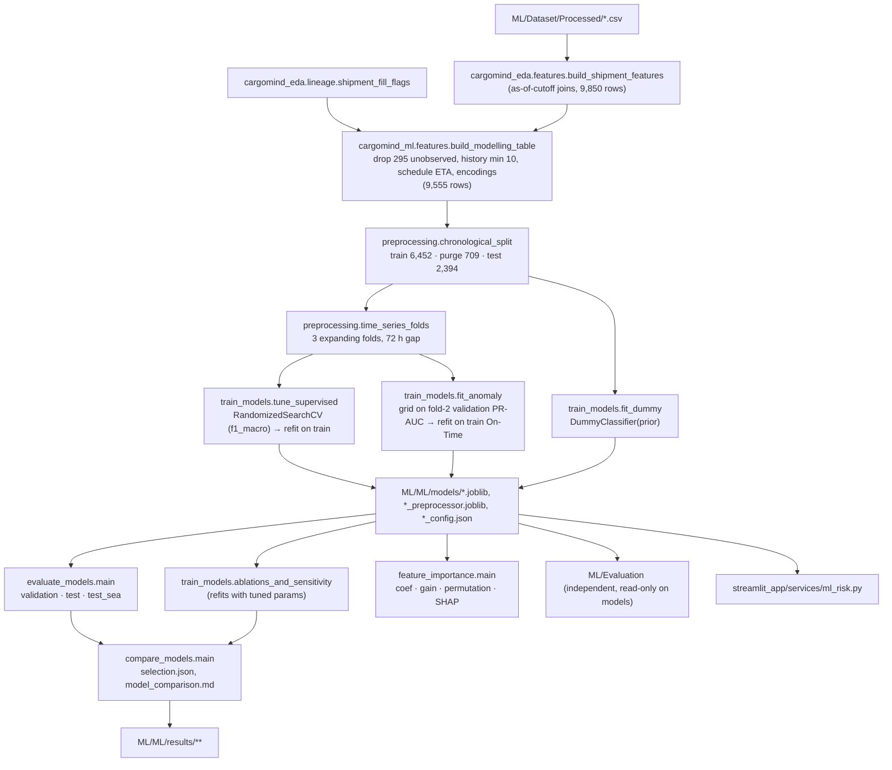

# 03 · Machine Learning Development

How the four supervised delay-risk classifiers and the two anomaly detectors are built, tuned, selected and saved. This document covers code and configuration. Results are summarised only where they drove a design or selection decision; the full evaluation is in [04_ML_Model_Evaluation.md](04_ML_Model_Evaluation.md).

**Related documents:** dataset, features and split → [01_ML_Dataset_Engineering.md](01_ML_Dataset_Engineering.md). EDA rationale → [02_ML_Exploratory_Data_Analysis.md](02_ML_Exploratory_Data_Analysis.md).

**Sources inspected:**
- `ML/ML/src/cargomind_ml/*.py`
- `ML/ML/scripts/run_ml_pipeline.py`
- `ML/ML/models/*_config.json`
- `ML/ML/results/**`
- `ML/ML/reports/ML_model_report.md`
- `streamlit_app/services/ml_risk.py`

---

## A. Problem formulation

| Item | Definition |
|---|---|
| Task 1 (supervised) | 3-class classification of `delay_status` ∈ {On-Time, At-Risk, Critical}, encoded 0/1/2 in ordinal order (`config.CLASSES`) |
| Task 2 (unsupervised) | anomaly score of the **origin port's operating state** at the cutoff. Labels are not used to fit; they serve only to select hyperparameters and to evaluate |
| Unit | one observed shipment (9,555 rows; [01 · §C](01_ML_Dataset_Engineering.md#c-data-integration)) |
| Prediction time | `departure_ts − 1 h` (`config.LAG_HOURS = 1`) |
| Inputs | 51 features in 12 groups for the classifiers; 15 operational-state features for the detectors ([01 · §E](01_ML_Dataset_Engineering.md#e-feature-engineering)) |
| Primary metric | **macro-F1** (`config.TUNING_SCORING = "f1_macro"`); "never accuracy" (config comment) |
| Secondary metrics | Critical recall and precision, At-Risk recall, log loss, ROC-AUC, Critical → On-Time rate, ordinal MAE |
| Imbalance | balanced class weights or sample weights; no oversampling |
| Reproducibility | `config.SEED = 42` everywhere; the ML report states that two runs gave identical metrics |

The two tasks are kept separate on purpose. `compare_models.py` tabulates them separately, and the anomaly scores are never turned into class predictions.

---

## B. Pipeline architecture

`ML/ML/scripts/run_ml_pipeline.py` runs `train_models.main()`, then `evaluate_models.main()`, `feature_importance.main()` and `compare_models.main()`, in that order. It takes about 6 minutes on 8 cores (ML report).



Outputs:

| Directory | Files |
|---|---|
| `ML/ML/results/data/` | `splits.csv`, `modelling_table.pkl`, `feature_catalog.csv`, `data_summary.json` |
| `ML/ML/results/metrics/` | `supervised_metrics.csv`, `test_predictions.csv`, `<model>_cv_results.csv` |
| `ML/ML/results/classification_reports/`, `confusion_matrices/` | one file per model × {validation, test, test_sea} |
| `ML/ML/results/anomaly/` | `anomaly_metrics.csv`, `<model>_tuning_grid.csv`, `test_anomaly_scores.csv`, `score_distribution_by_class.csv` |
| `ML/ML/results/feature_importance/` | `importance_by_feature.csv`, `group_permutation_importance.csv`, `importance_share_by_group.csv`, `logistic_regression_coefficients.csv` |
| `ML/ML/results/comparison/` | `supervised_comparison_{cv,validation,test,test_sea}.csv`, `anomaly_comparison_*.csv`, `ablation_and_sensitivity.csv`, `selection.json`, `model_comparison.md` |
| `ML/ML/results/figures/` | confusion grids, anomaly score distributions, group permutation, LR coefficients, SHAP for XGBoost and LightGBM |

---

## C. Preprocessing

Every transformer is fitted inside the sklearn `Pipeline` (`("prep", …), ("model", …)`). It therefore sees only the rows being fitted: a CV fold's training rows during tuning, and the full training period at refit.

`make_preprocessor(kind, numeric=NUMERIC, categorical=CATEGORICAL)` in `preprocessing.py`:

| Family (`PREPROCESSING`) | Used by | Numeric (44 columns) | Categorical (7 columns) |
|---|---|---|---|
| `linear` | Logistic Regression | `SimpleImputer(median, add_indicator=True)` → `StandardScaler` | `OneHotEncoder(handle_unknown="ignore")` |
| `forest` | Random Forest | `SimpleImputer(median, add_indicator=True)`, no scaling | one-hot |
| `boosting` | XGBoost, LightGBM | `passthrough`; NaN handled natively | one-hot |

Notes:
- `ColumnTransformer(remainder="drop")` passes only the 51 features through.
- The missing-value indicators mainly capture structural NaN: hub features on direct routes, and history with fewer than 10 prior arrivals.
- Unseen categories (for example a new carrier) become an all-zero one-hot.
- Ablations reuse `make_preprocessor` with subsets of `numeric` and `categorical`.

**Anomaly preprocessing** (`make_anomaly_preprocessor(scale_globally)`):
- `PortRelativeScaler` (§E.1), then
- `StandardScaler`, but only for the One-Class SVM (`scale_globally=True`).

**Class weights:**
- `balanced_sample_weight(y)` wraps `compute_sample_weight("balanced", y)`. It is recomputed on whichever rows are being fitted.
- LR and RF use `class_weight="balanced"`; RF can also select `"balanced_subsample"`.
- LightGBM uses `class_weight="balanced"`.
- XGBoost uses `BalancedXGBClassifier`.

---

## D. Supervised classifiers

All four use the same 51 features, the same folds and the same search: `RandomizedSearchCV` with `n_iter = config.N_ITER[name]`, `cv = folds`, `refit = "f1_macro"`, `random_state = 42` and `error_score = "raise"`.

The search also records f1_weighted, accuracy, Critical recall, At-Risk recall and neg log loss (`SCORING` in `train_models.py`).

### D.1 Logistic Regression (`logistic_regression_model.py`)

| Item | Value |
|---|---|
| Estimator | `LogisticRegression(solver="saga", max_iter=5000, tol=1e-3, class_weight="balanced", random_state=42)`, multinomial softmax for 3 classes |
| Preprocessing | `linear` |
| Search space (`n_iter = 20`) | `C ~ loguniform(1e-3, 10)`, `penalty ∈ {l1, l2}` |
| **Selected** (`models/logistic_regression_config.json`) | `C = 0.1256`, `penalty = "l1"` |
| Tuning time | 26.0 s |
| CV macro-F1 (mean of 3 folds) | 0.633 (sd 0.015) |
| Interpretation | `coefficients(pipeline)` gives log-odds per 1 SD for each encoded feature and class. The L1 penalty zeroes the At-Risk column, which then acts as the reference class (ML report §5) |

### D.2 Random Forest (`random_forest_model.py`)

| Item | Value |
|---|---|
| Estimator | `RandomForestClassifier(n_estimators=500, n_jobs=1, random_state=42, class_weight="balanced")` |
| Preprocessing | `forest` |
| Search space (`n_iter = 30`) | `n_estimators ∈ {300, 500, 800}`, `max_depth ∈ {None, 8, 12, 16, 24}`, `min_samples_leaf ∈ {1, 2, 5, 10, 20, 40}`, `max_features ∈ {sqrt, 0.2, 0.35, 0.5}`, `class_weight ∈ {balanced, balanced_subsample}` |
| **Selected** | `n_estimators 500`, `max_depth None`, `min_samples_leaf 5`, `max_features "sqrt"`, `class_weight "balanced_subsample"` |
| Tuning time | 102.7 s |
| CV macro-F1 | 0.583 (sd 0.007) |

### D.3 XGBoost (`xgboost_model.py`)

| Item | Value |
|---|---|
| Estimator | `BalancedXGBClassifier(objective="multi:softprob", eval_metric="mlogloss", tree_method="hist", n_jobs=1, random_state=42)`. This subclass of `XGBClassifier` injects `balanced_sample_weight(y)` in `fit` when no weights are passed |
| Preprocessing | `boosting` |
| Search space (`n_iter = 40`) | `n_estimators ~ randint(150, 800)`, `learning_rate ~ loguniform(0.01, 0.2)`, `max_depth ~ randint(2, 8)`, `min_child_weight ∈ {1, 3, 5, 10, 20}`, `subsample ~ U(0.6, 1.0)`, `colsample_bytree ~ U(0.4, 1.0)`, `reg_lambda ~ loguniform(0.1, 20)`, `gamma ∈ {0, 0.1, 0.5, 1}` |
| **Selected** | `n_estimators 419`, `learning_rate 0.102`, `max_depth 3`, `min_child_weight 3`, `subsample 0.731`, `colsample_bytree 0.419`, `reg_lambda 4.71`, `gamma 0.1` |
| Tuning time | 42.3 s |
| CV macro-F1 | 0.621 (sd 0.017) |

### D.4 LightGBM (`lightgbm_model.py`)

| Item | Value |
|---|---|
| Estimator | `LGBMClassifier(objective="multiclass", class_weight="balanced", subsample_freq=1, n_jobs=1, random_state=42, verbose=-1)` |
| Preprocessing | `boosting` |
| Search space (`n_iter = 40`) | `n_estimators ~ randint(150, 800)`, `learning_rate ~ loguniform(0.01, 0.2)`, `num_leaves ∈ {7, 15, 31, 63}`, `max_depth ∈ {−1, 4, 6, 8}`, `min_child_samples ∈ {10, 20, 40, 80, 160}`, `subsample ~ U(0.6, 1.0)`, `colsample_bytree ~ U(0.4, 1.0)`, `reg_lambda ~ loguniform(1e-3, 20)`, `reg_alpha ~ loguniform(1e-3, 5)` |
| **Selected** | `n_estimators 418`, `learning_rate 0.0343`, `num_leaves 15`, `max_depth 6`, `min_child_samples 80`, `subsample 0.918`, `colsample_bytree 0.517`, `reg_lambda 0.0245`, `reg_alpha 0.0812` |
| Tuning time | 41.0 s |
| CV macro-F1 | 0.625 (sd 0.016) |

**Reference model.** `fit_dummy` saves `DummyClassifier(strategy="prior")` as `models/dummy_prior.joblib`. Its argmax is always On-Time.

---

## E. Anomaly detection

Both detectors are fitted on **On-Time training shipments only** (the "normal" class). Their inputs are `ANOMALY_INPUT_COLUMNS` = `ANOMALY_FEATURES` + `origin_port_id`.

| Input set | Columns |
|---|---|
| `ANOMALY_PORT_RELATIVE` (10, standardised per origin port) | `o_port_utilization_pct`, `o_util_max24`, `o_util_change24`, `o_anchor_mean24`, `o_container_dwell_hours`, `o_vessel_time_in_port_hours`, `o_arrivals_sum24`, `wx_o_gust_max24`, `wx_o_precip_sum24`, `wx_o_pressure_change24` |
| `ANOMALY_RAW` (5, passed through) | `o_labour_disrupted_share24`, `wx_o_thunderstorm_hours24`, `dis_o_active_any`, `dis_o_active_hours_elapsed`, `dis_o_started_72h_n` |

### E.1 Port-relative scaling (`PortRelativeScaler`)

The class docstring explains the motivation: "Normal operating levels differ by port (e.g. NLRTM runs at saturation), so a detector on raw values would flag 'large port' rather than 'unusual state'."

- **`fit`:**
  - learns column medians (used for imputation);
  - learns the global mean and SD of the 10 port-relative columns;
  - learns the per-origin-port mean and SD.

  A per-port SD of 0 is replaced by 1, and a missing per-port SD falls back to the global SD.
- **`transform`:**
  - imputes with the medians;
  - computes `z = (x − μ_port) / σ_port`, using the global statistics for unseen ports;
  - appends the 5 raw columns (imputed).

  Output names are `<col>_portz` followed by the raw columns.

### E.2 Isolation Forest (`isolation_forest_model.py`)

| Item | Value |
|---|---|
| Pipeline | `PortRelativeScaler` → `IsolationForest(random_state=42, n_jobs=-1)`, no global scaling (isolation splits are scale-invariant per feature) |
| Grid (18) | `n_estimators ∈ {200, 500}`, `max_samples ∈ {128, 256, 1024}`, `max_features ∈ {0.5, 0.75, 1.0}` |
| **Selected** (`models/isolation_forest_config.json`) | `n_estimators 500`, `max_samples 256`, `max_features 0.5` |
| Score | `anomaly_score = −score_samples(X)` (higher = more anomalous) |
| Fit rows | 3,352 (all training On-Time rows) |
| Validation (fold 2) | PR-AUC delayed 0.764, ROC-AUC delayed 0.673, PR-AUC Critical 0.556 |
| **Flag threshold** | **0.5609** |

### E.3 One-Class SVM (`one_class_svm_model.py`)

| Item | Value |
|---|---|
| Pipeline | `PortRelativeScaler` → `StandardScaler` → `OneClassSVM(cache_size=1000)` |
| Grid (35) | RBF: `nu ∈ {0.02, 0.05, 0.1, 0.2}` × `gamma ∈ {scale, 0.01, 0.03, 0.1, 0.3}`; sigmoid: `nu ∈ {0.05, 0.1, 0.2}` × `gamma ∈ {scale, 0.01, 0.03}`; poly: `degree ∈ {2, 3}` × `nu ∈ {0.05, 0.1, 0.2}`, `gamma = scale` |
| **Selected** | `kernel "rbf"`, `nu 0.2`, `gamma 0.01` |
| Score | `anomaly_score = −decision_function(X)` |
| Fit rows | `fit_rows` takes a seeded subsample of `OCSVM_MAX_TRAIN = 3000` of the 3,352 normal rows, because kernel SVM cost grows between O(n²) and O(n³) |
| Validation (fold 2) | PR-AUC delayed 0.755, ROC-AUC delayed 0.653, PR-AUC Critical 0.490 |
| **Flag threshold** | **75.87** |

### E.4 Anomaly fitting procedure (`train_models.fit_anomaly`)

1. For each grid point, fit on fold 2's training On-Time rows and score fold 2's validation block.
2. Rank the grid by **`average_precision_score`, with positive = delayed (At-Risk or Critical)**. Labels are used only for this selection.
3. Refit the best configuration on **all** training On-Time rows (subsampled for the One-Class SVM).
4. Set `threshold = quantile(anomaly_score(train On-Time), ANOMALY_FLAG_QUANTILE = 0.95)`. This is a 5 % false-alarm budget on normal training shipments.
5. Save `{"pipeline", "threshold"}` to `models/<name>.joblib` and the config to `<name>_config.json`.

Because the refit in step 3 includes the validation block, validation anomaly metrics are partly in-sample. See [04 · §F](04_ML_Model_Evaluation.md#f-anomaly-detection-evaluation).

---

## F. Model training and selection

### Tuning protocol (`train_models.tune_supervised`)

- The search runs on `ctx["train"]` only. **The test period is never passed to the search** (confirmed in [04 · §B](04_ML_Model_Evaluation.md#b-split-verification)).
- `search.best_estimator_` is refit on all 6,452 training rows.
- `cv_results_`, best parameters, search space, per-fold CV scores, `n_train` and the tuning time are all saved.

| Model | CV macro-F1 (mean) | sd | CV Critical recall | CV At-Risk recall |
|---|---:|---:|---:|---:|
| Logistic Regression | **0.633** | 0.015 | **0.692** | **0.648** |
| Random Forest | 0.583 | 0.007 | 0.493 | 0.604 |
| XGBoost | 0.621 | 0.017 | 0.554 | 0.627 |
| LightGBM | 0.625 | 0.016 | 0.577 | 0.641 |

Source: `ML/ML/results/comparison/supervised_comparison_cv.csv`.

### Selection rules (`compare_models.py`, docstring: "fixed before looking at test results")

| Pick | Rule | Result (`results/comparison/selection.json`) |
|---|---|---|
| Best overall supervised | highest mean CV macro-F1 | **Logistic Regression** |
| Best Critical detector | highest mean CV Critical recall (reported with Critical precision) | **Logistic Regression** |
| Most interpretable | fixed choice | **Logistic Regression** |
| Best anomaly detector | highest fold-2 validation PR-AUC (delayed) | **Isolation Forest** (0.764 vs 0.755) |
| For reference only | highest test macro-F1 / Critical recall | Logistic Regression / Logistic Regression |

**Why a linear model wins.** The ML report (§4) gives this explanation after selection, not as an input to it. The generator defines delay as a linear sum of operational terms plus Gaussian noise ([01 · §B.5](01_ML_Dataset_Engineering.md#b5-shipments-and-the-delay-formula-section-8-lines-295366)), so a multinomial linear model is close to the true form, and the trees have no interactions to find. The report keeps XGBoost as the challenger for real data.

### Ablations (`train_models.ablations_and_sensitivity`)

Each supervised model is refit with its **tuned hyperparameters** on 8 variants and scored on test. The variants:
1. full model (reference);
2. no port/carrier identity;
3. no operational state;
4. no historical delay rates;
5. train only on labels available at the test start;
6. exclude shipments with filled inputs;
7. sea only;
8. prediction 24 h before departure (`prepare_data(lag_hours=24)`).

Results are in [04 · §G](04_ML_Model_Evaluation.md#g-robustness-and-statistical-analysis).

---

## G. Probability and decision thresholds

| Model / output | Decision rule in the ML stage | Threshold value |
|---|---|---|
| LR, RF, XGBoost, LightGBM | **argmax** of `predict_proba` (`classification_metrics`: `pred = proba.argmax(1)`) | none (implicit) |
| Probabilities | raw `predict_proba`, **not recalibrated** in the ML stage | — |
| Isolation Forest | flag if `−score_samples > threshold` | **0.5609** (95th percentile of training On-Time scores) |
| One-Class SVM | flag if `−decision_function > threshold` | **75.87** (same rule) |

**Thresholds added by the evaluation stage only.** These are not part of the saved models. `ML/Evaluation/src/cargomind_eval/operational.py` defines `decide(p, t)`: predict Critical if P(Critical) ≥ t, otherwise the larger of P(On-Time) and P(At-Risk). It chooses `t` on pooled out-of-fold validation predictions:

| Model | max macro-F1 | Critical recall ≥ 0.80 | min expected cost (assumed costs) |
|---|---:|---:|---:|
| Logistic Regression | 0.56 | 0.36 | 0.22 |
| Random Forest | 0.32 | 0.25 | 0.08 |
| XGBoost | 0.41 | 0.20 | 0.06 |
| LightGBM | 0.47 | 0.21 | 0.05 |

Source: `ML/Evaluation/metrics/operational_policies.csv`. The evaluation also tested prior correction and vector scaling of the probabilities (`calibration.py`). Both effects and the recommended policy are in [04 · §E](04_ML_Model_Evaluation.md#e-operational-threshold-policies).

Because the classifiers are trained with balanced weights, their raw probabilities lean toward a uniform prior. On test, mean P(Critical) is 0.13–0.16 against a 9 % observed share ([04 · §E](04_ML_Model_Evaluation.md#e-operational-threshold-policies)).

---

## H. Inference architecture

| Step | Implementation | Status |
|---|---|---|
| Saved artifact | `ML/ML/models/<name>.joblib` holds the **full** fitted `Pipeline` (preprocessor + model). The preprocessor alone is also saved as `<name>_preprocessor.joblib`. Anomaly artifacts are a dict `{"pipeline", "threshold"}` | available |
| Configuration | `ML/ML/models/<name>_config.json` (best params, search space, CV scores, feature list, seed) | available |
| Feature construction for new shipments | `build_modelling_table` builds features for the **whole historical dataset** from `ML/Dataset/Processed`. There is no function that turns a single new raw shipment into the 51 features | **gap** |
| Serving adapter | `streamlit_app/services/ml_risk.py`: `load_classifier(name="logistic_regression")` (cached `joblib.load`) and `predict_delay_risk(features)`. It checks that all `FEATURES` are present and returns `p_On-Time`, `p_At-Risk`, `p_Critical` and `predicted_class` (argmax) | available; scores **pre-built feature rows only** (docstring and `docs/architecture.md`, "Known gaps") |
| Anomaly serving | none in the adapter | not implemented |
| Threshold / calibration at inference | none; the adapter uses argmax and raw probabilities | not implemented |

A minimal scoring example:

```python
from cargomind_ml.features import FEATURES
import joblib
pipe = joblib.load("ML/ML/models/logistic_regression.joblib")
proba = pipe.predict_proba(rows[FEATURES])   # rows must already contain the 51 model features
```

---

## I. Source code map

| File | Function / class | Responsibility | Inputs | Outputs |
|---|---|---|---|---|
| `ML/ML/src/cargomind_ml/config.py` | constants, `ensure_dirs` | paths, seed, cutoff, split, CV, search budgets, anomaly quantile, bootstrap reps | — | directories |
| `ML/ML/src/cargomind_ml/features.py` | `build_modelling_table`, `feature_catalog`, `FEATURE_GROUPS`, `ANOMALY_FEATURES` | modelling table, feature lists, exclusion reasons | `ML/Dataset/Processed` via `cargomind_eda` | DataFrame + log; catalogue |
| `ML/ML/src/cargomind_ml/preprocessing.py` | `chronological_split`, `time_series_folds`, `make_preprocessor`, `PortRelativeScaler`, `make_anomaly_preprocessor`, `balanced_sample_weight` | splits, folds, preprocessing | modelling table | split labels, fold indices, transformers |
| `ML/ML/src/cargomind_ml/logistic_regression_model.py` | `build_pipeline`, `param_distributions`, `coefficients` | LR definition and coefficients | — | Pipeline; coefficient table |
| `ML/ML/src/cargomind_ml/random_forest_model.py` | `build_pipeline`, `param_distributions` | RF definition | — | Pipeline |
| `ML/ML/src/cargomind_ml/xgboost_model.py` | `BalancedXGBClassifier`, `build_pipeline`, `param_distributions` | XGBoost with balanced weights | — | Pipeline |
| `ML/ML/src/cargomind_ml/lightgbm_model.py` | `build_pipeline`, `param_distributions` | LightGBM definition | — | Pipeline |
| `ML/ML/src/cargomind_ml/isolation_forest_model.py` | `build_pipeline`, `param_grid`, `anomaly_score`, `fit_rows` | Isolation Forest | normal rows | Pipeline; scores |
| `ML/ML/src/cargomind_ml/one_class_svm_model.py` | `build_pipeline`, `param_grid`, `anomaly_score`, `fit_rows` | One-Class SVM with ≤ 3,000-row subsample | normal rows | Pipeline; scores |
| `ML/ML/src/cargomind_ml/train_models.py` | `prepare_data`, `tune_supervised`, `fit_dummy`, `fit_anomaly`, `ablations_and_sensitivity`, `main` | orchestration of data, tuning, fitting and ablations | config | `models/*`, `results/data/*`, `results/metrics/*_cv_results.csv`, `results/anomaly/*_tuning_grid.csv`, `results/comparison/ablation_and_sensitivity.csv` |
| `ML/ML/src/cargomind_ml/evaluate_models.py` | `classification_metrics`, `day_block_bootstrap`, `evaluate_supervised`, `anomaly_metrics`, `evaluate_anomaly`, `plot_confusion_grid` | metrics on validation / test / test_sea, bootstrap CIs, plots | saved models, ctx | `results/metrics/*`, `classification_reports/*`, `confusion_matrices/*`, `anomaly/*`, figures |
| `ML/ML/src/cargomind_ml/feature_importance.py` | `native_importances`, `lr_coefficients`, `permutation_by_feature`, `permutation_by_group`, `shap_values`, `main` | interpretability on the test period (`N_REPEATS = 5`) | saved models, test | `results/feature_importance/*`, figures |
| `ML/ML/src/cargomind_ml/compare_models.py` | `supervised_tables`, `anomaly_tables`, `main` | comparison tables and pre-registered selection | metrics, configs | `results/comparison/*` |
| `ML/ML/scripts/run_ml_pipeline.py` | `main` | end-to-end entry point (**overwrites** `models/` and `results/`) | — | all of the above |
| `streamlit_app/services/ml_risk.py` | `load_classifier`, `predict_delay_risk` | serving adapter | feature rows | probabilities + class |

---

## J. Limitations of the ML implementation

1. **No raw-shipment → feature inference path.** Only pre-built feature rows can be scored (§H).
2. **Raw, balanced-weight probabilities are served.** No calibration or threshold is saved with the models; both exist only as evaluation analyses.
3. **Selection uses a single validation design.** There are 3 folds over about 4 weeks, and the folds train on labels that would not yet be known (42–62 %).
4. **The linear model's advantage reflects the generator** (an additive formula). The tree models may be preferable on real data with interactions.
5. **Identity one-hots slightly overfit LR.** Removing them improves test macro-F1 (0.654 → 0.674). This was found on the test set, so it needs CV confirmation before adoption (ML report §6).
6. **Anomaly selection uses delay labels as a proxy** for "unusual port conditions", and the final refit includes the validation block.
7. **The One-Class SVM is trained on a subsample** (3,000 of 3,352 rows) and scales worse with more data.
8. **Running `run_ml_pipeline.py` overwrites** `ML/ML/models/` and `ML/ML/results/` (`docs/setup_and_reproduction.md`).
9. **Package versions are not stored with each model.** The evaluation stage records them in `ML/Evaluation/validation/run_info.json`. Requirements are pinned in `ML/ML/requirements.txt`.
